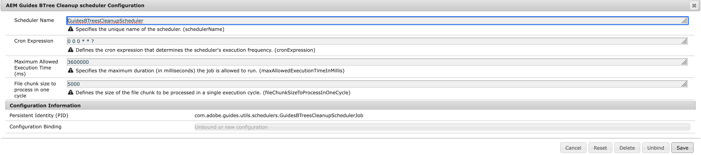
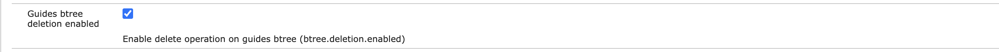

# Configurar limpeza do armazenamento de referência

Configure o trabalho de limpeza do repositório de Referência e gerencie a configuração `Guides BTree deletion` para manter o sistema otimizado e o armazenamento limpo.

## Configurar trabalho de limpeza de armazenamento de referência

As guias a seguir fornecem instruções para configurar o trabalho de limpeza da loja de referência com base na configuração do Experience Manager Guides: Cloud Service ou No local.

>[!BEGINTABS]

>[!TAB Cloud Service]

1. Use as instruções fornecidas em [Substituições de configuração](download-install-config-override.md) para criar o arquivo de configuração.

1. No arquivo de configuração, forneça os seguintes detalhes (propriedade):

   | PID | Chave de propriedade | Valor de propriedade |
   |---|---|---|
   | `com.adobe.guides.utils.schedulers.GuidesBTreesCleanupSchedulerJob` | `cronExpression` | **Valor padrão:** &quot;0 0 0 * * * ?&quot; |

>[!TAB No local]

1. Abra a página Configuração do console da Web do Adobe Experience Manager.

   O URL padrão para acessar a página de configuração é:

   ```http
   http://<server name>:<port>/system/console/configMgr
   ```

1. Procure e selecione o pacote *com.adobe.guides.utils.schedulers.GuidesBTreesCleanupSchedulerJob*.

1. Atualize a expressão cron para configurar a frequência de execução do trabalho do agendador de limpeza de armazenamento de referência.

1. Configure o Agendador de limpeza de armazenamento de referência conforme mostrado abaixo.

   

1. Selecione **Salvar**.

>[!ENDTABS]

## Configurar a opção de ativação da exclusão da árvore B dos guias

As guias a seguir fornecem instruções para ativar a configuração com base na configuração do Experience Manager Guides: Cloud Service ou No local.

>[!BEGINTABS]

>[!TAB Cloud Service]

1. Use as instruções fornecidas em [Substituições de configuração](download-install-config-override.md) para criar o arquivo de configuração.

1. No arquivo de configuração, forneça os seguintes detalhes (propriedade):

   | PID | Chave de propriedade | Valor de propriedade |
   |---|---|---|
   | `com.adobe.fmdita.config.ConfigManager` | `btree.deletion.enabled` | **Valor padrão:** &quot;True&quot; |

>[!TAB No local]

1. Abra a página Configuração do console da Web do Adobe Experience Manager.

   O URL padrão para acessar a página de configuração é:

   ```http
   http://<server name>:<port>/system/console/configMgr
   ```

1. Procure e selecione o pacote *com.adobe.fmdita.config.ConfigManager*.
1. Habilitar a configuração **Exclusão de btree de guias habilitada** (btree.deletion.enabled).

   

1. Selecione **Salvar**.

>[!ENDTABS]
