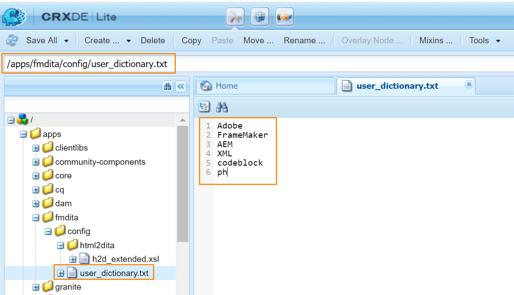

# Personalizar o dicionário padrão do AEM {#id209SD8000WU}

O Editor pode ser configurado para usar o verificador ortográfico do AEM ou o verificador ortográfico do navegador. Se optar por trabalhar com o verificador ortográfico do AEM, você terá a flexibilidade de definir sua lista de palavras personalizadas. Essas palavras personalizadas são adicionadas ao dicionário do AEM e essas palavras não são sinalizadas \(como incorreto\) no Editor.

As guias a seguir fornecem instruções para criar sua lista de palavras personalizadas, que são adicionadas ao dicionário da AEM com base na configuração do Experience Manager Guides: Cloud Service ou No local.

>[!BEGINTABS]

>[!TAB Cloud Service]

1. Crie o arquivo user\_dictionary.txt com uma lista de palavras que você deseja definir no dicionário personalizado.

   >[!NOTE]
   >
   > Cada palavra personalizada deve ser definida em uma nova linha.

1. Salve o arquivo no seguinte local no repositório Git do Cloud Manager:

   /apps/fmdita/config

1. Salve o arquivo.

   Confirme as alterações e execute o pipeline de Cloud Manager \(CI/CD\) para implantar alterações de configuração.

Os autores precisariam reiniciar a sessão do editor para atualizar a lista de palavras personalizadas no dicionário do AEM.

>[!TAB No local]

1. Faça logon no AEM e abra o modo CRXDE Lite.

1. Navegue até o seguinte nó:

   /apps/fmdita/config

1. Crie um novo arquivo chamado user\_dictionary.txt.

1. Abra o arquivo e adicione uma lista de palavras que deseja definir no dicionário personalizado.

   A captura de tela a seguir mostra uma lista de palavras personalizadas adicionada ao arquivo user\_dictionary.txt:

   {width="650"}

1. Salvar e fechar o arquivo.

Os autores precisariam reiniciar a sessão do editor para atualizar a lista de palavras personalizadas no dicionário do AEM.

>[!ENDTABS]

**Tópico pai:**&#x200B;[&#x200B; Personalizar editor](customize-overview.md)
