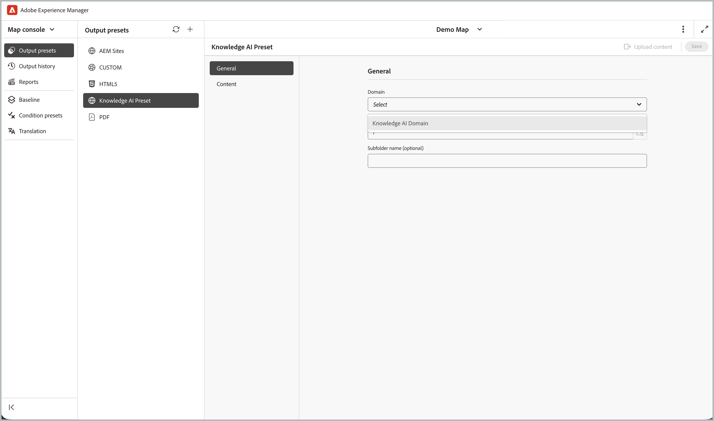

# Conectar o Adobe Experience Manager Guides com a IA de conhecimento do Guides (Beta)

>[!IMPORTANT]
>
> Esse recurso está desativado por padrão. Para ativar o recurso IA de conhecimento dos guias, entre em contato com a equipe de sucesso do cliente.

Este artigo fornece aos administradores e engenheiros de conteúdo o processo completo para configurar o acesso à IA de conhecimento dos guias e fazer upload de conteúdo do Experience Manager Guides para consumo na IA de conhecimento.

## Visão geral do processo

| Etapa | O que você fará |
|---|---|
| 1 | Crie uma Conta de Serviço no Adobe Developer Console e configure-a para o seu ambiente. |
| 2 | Recupere o email da conta técnica do arquivo de credenciais da Conta de Serviço. |
| 3 | Conceda acesso à Conta de serviço na IA do conhecimento, criando uma função e adicionando o usuário. |
| 4 | Configure uma predefinição de saída da IA de conhecimento no Experience Manager Guides e faça upload do conteúdo. |


## Pré-requisitos

Verifique se você tem o seguinte acesso e permissões antes de iniciar:

| Requisito | Propósito |
|---|---|
| Console do desenvolvedor da Adobe | Crie a Conta de serviço e baixe suas credenciais JSON. |
| Adobe Experience Manager Guides | Crie conteúdo e configure a predefinição de saída para a IA de conhecimento. |
| [IA de conhecimento](https://guidesai.adobe.io/) | Gerencie funções e usuários e receba o conteúdo carregado. |
| Permissão: Criar Contas de Serviço | Obrigatório no Adobe Developer Console para criar uma Conta de serviço. |
| Permissão: gerenciar usuários e funções na IA de conhecimento | Necessário para conceder acesso à Conta de serviço no Knowledge AI. |

## Criar uma Conta de Serviço

A IA de conhecimento usa uma conta de serviço para se autenticar com segurança e acessar conteúdo.

1. Siga as instruções em [Configurar IMT de Microsserviços](https://experienceleague.adobe.com/en/docs/experience-manager-guides/using/knowledge-base/kb-articles/publishing/configure-microservices-imt-config).

1. Crie uma nova Conta de serviço e baixe o arquivo de credenciais JSON gerado.

1. Defina as configurações de ambiente necessárias usando as credenciais baixadas.

Depois de concluída, a conta de serviço deve ser associada com êxito ao seu ambiente.

>[!NOTE]
>
> Se você já criou e configurou uma conta de serviço para o seu ambiente, é possível prosseguir para a próxima etapa.


## Recupere o email da conta técnica

Para conceder acesso à IA do conhecimento, identifique a Conta de serviço.

1. Abra o arquivo JSON da conta de serviço baixado.
1. Procure pelo nome de campo `technical_account_email`. Exibir um valor semelhante ao seguinte:

   ```json
   {
   "technical_account_email": "a1b2c3d4e5f6@techacct.adobe.com"
   }
   ```

1. Copie o endereço de email associado a `technical_account_email`. Você usará esse endereço de email na próxima etapa.

## Conceder acesso no Knowledge AI

Para permitir que a Conta de serviço gerencie e faça upload de conteúdo, adicione-o à IA de conhecimento com as permissões apropriadas.

1. Abra a [IA de conhecimento](https://guidesai.adobe.io/).
1. Navegue até **Segurança > Funções** e crie uma função com as permissões mínimas necessárias.
1. Navegue até **Segurança > Usuários > Adicionar usuário**. Adicione um novo usuário usando o `technical_account_email` copiado do JSON da Conta de Serviço, selecione os domínios na lista suspensa **Domínios** e atribua a função criada na etapa anterior.

A Conta de Serviço agora está autorizada a realizar operações de administração e upload de conteúdo.

## Configurar a predefinição da IA de conhecimento e fazer upload do conteúdo

Para publicar conteúdo na IA de conhecimento, configure o Experience Manager Guides depois de definir as permissões.

1. Abra o **Console de mapas** no Experience Manager Guides.
1. Navegue até a guia **Predefinições de saída**.
1. Selecione o ícone + para criar uma predefinição de saída.
1. Selecione **IA de Conhecimento** na lista suspensa **Tipo** na caixa de diálogo **Nova predefinição de saída**. Insira um **Nome** e selecione **Adicionar ao perfil de pasta atual** para criar uma predefinição de saída no perfil de pasta atual.

   

1. Selecione **Adicionar**. A predefinição da IA de conhecimento é criada.
1. Abra a predefinição configurada da IA de conhecimento.
1. Selecione o domínio para o qual a função foi concedida a `technical_account_email` e selecione **Fazer upload do conteúdo**. Isso aciona o fluxo de trabalho de upload de conteúdo para a IA de conhecimento. Aguarde a conclusão do processo de upload.

   

1. Após a conclusão do carregamento, selecione **Abrir na IA de Conhecimento**. Isso abre o bate-papo da IA de conhecimento no domínio, usando o conteúdo carregado.

   

Você configurou a Conta de serviço com êxito, atribuiu as permissões necessárias e disponibilizou o conteúdo do Experience Manager Guides na IA de conhecimento. Sempre que quiser publicar conteúdo atualizado, crie uma nova predefinição da IA de conhecimento e siga as etapas descritas na seção [configurar a predefinição da IA de conhecimento e carregar seu conteúdo](#configure-knowledge-ai-preset-and-upload-content) acima.


