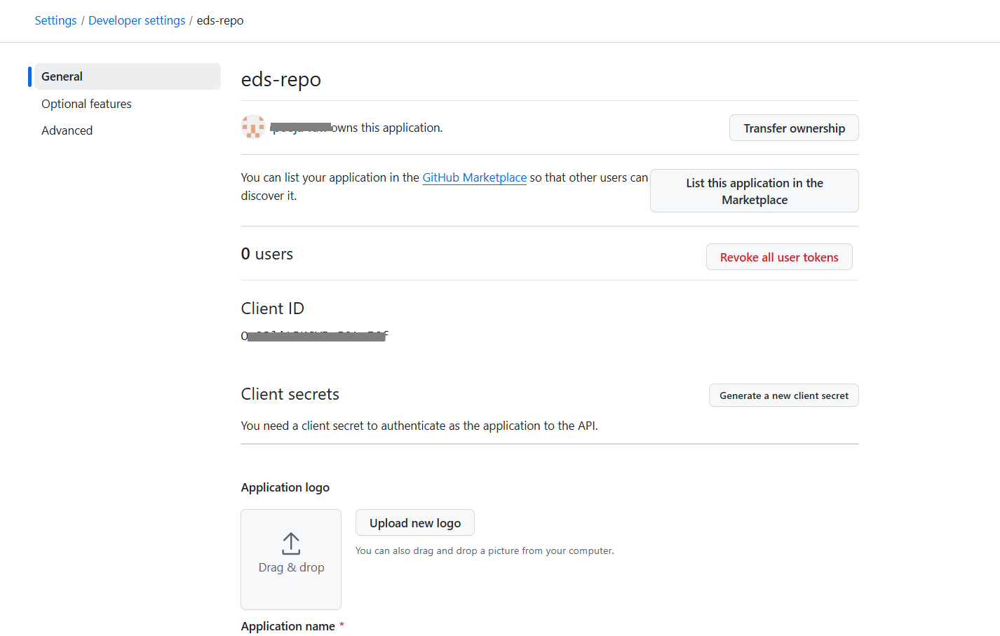
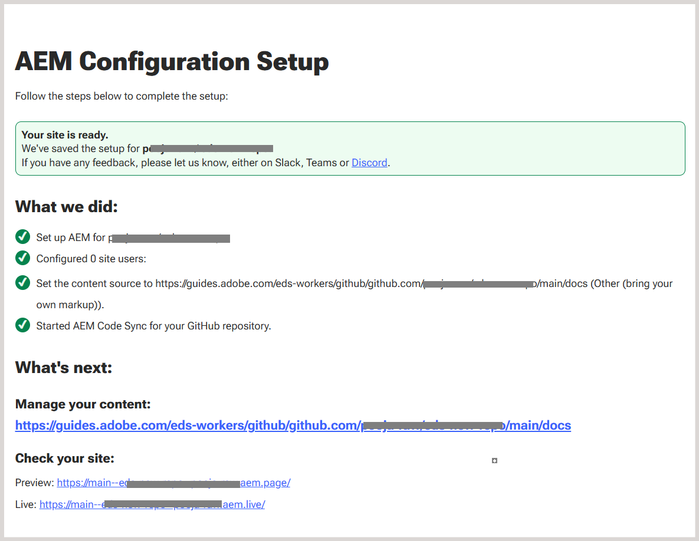

# EXPERIENCE MANAGER GUIDES e EDGE DELIVERY SERVICES

O Adobe Experience Manager Guides permite publicar seu conteúdo DITA diretamente no Edge Delivery Services (EDS) por meio de um perfil de publicação dedicado com base no GitHub. Esse recurso permite que as organizações forneçam experiências de documentação responsivas de alto desempenho enquanto mantêm fluxos de trabalho de criação baseados em DITA no Experience Manager Guides.

Para obter mais detalhes sobre o uso do EDS no Adobe Experience Manager, consulte [Visão geral do Edge Delivery Services](https://experienceleague.adobe.com/pt-br/docs/experience-manager-cloud-service/content/edge-delivery/overview).

Para habilitar a publicação do Experience Manager Guides para o EDS, você deve concluir uma série de etapas de configuração no GitHub e no Experience Manager Guides. As seções abaixo descrevem cada etapa em sequência e explicam como elas funcionam juntas no fluxo de trabalho de publicação geral.

1. [Configurar o GitHub para EDS](#set-up-and-configure-github-for-eds)
2. [Criar e configurar um perfil de publicação para EDS no Experience Manager Guides](#create-and-configure-a-publish-profile-for-eds-in-experience-manager)
3. [Personalizar saída usando blocos EDS](#customize-output-using-eds-blocks)

Para obter uma apresentação rápida em vídeo, exiba [Publicação no AEM Guides](https://experienceleague.adobe.com/pt-br/docs/experience-manager-guides/using/knowledge-base/expert-session/publishing-in-aem-guides-aug25).


## Configurar o GitHub para EDS

Esta seção descreve como instalar e configurar o GitHub para uso com o EDS. Ele aborda a criação de um repositório usando a matriz do Adobe, a conexão do GitHub ao Adobe Experience Manager por meio da Sincronização de código do AEM, a configuração dos aplicativos GitHub e OAuth necessários e a definição do ponto de montagem do repositório usado para publicar conteúdo.

### Criar um repositório GitHub para EDS

O EDS requer um repositório GitHub com uma estrutura predefinida. O Adobe fornece um repositório padrão oficial projetado especificamente para usuários do Experience Manager Guides.

Execute as seguintes etapas para criar seu repositório:

1. Abra o repositório de modelos padronizados do Experience Manager Guides [aem-guides-boilerplate](https://github.com/adobe/aem-guides-boilerplate).
   

2. Crie um novo repositório usando este modelo. Saiba mais sobre [Criação de um repositório a partir de um modelo](https://docs.github.com/en/repositories/creating-and-managing-repositories/creating-a-repository-from-a-template). Verifique se a visibilidade do repositório está definida como *Pública* para que possa ser acessada pelo EDS.

   

O repositório agora é criado e se alinha à estrutura do modelo padronizado.


### Criar um novo aplicativo OAuth

Um aplicativo OAuth é necessário para autenticar usuários ao criar um perfil de publicação de EDS no Experience Manager Guides. Habilita um fluxo de logon seguro usando uma *ID de Cliente* e um *Segredo do Cliente*.

Execute as seguintes etapas para criar um novo aplicativo OAuth:

1. No GitHub, navegue até a barra lateral esquerda e selecione **Configurações do desenvolvedor**.
2. Na barra lateral esquerda, selecione **Aplicativos OAuth**.
3. Selecione **Novo aplicativo OAuth**.

   {width="650"}

4. Registre seu aplicativo fornecendo os seguintes detalhes obrigatórios:

   - **Nome do aplicativo**: insira o nome do seu repositório EDS
   - **URL da Página Inicial**: Insira a URL para a instância do Experience Manager Guides. (Para formato de URL de exemplo, consulte a etapa 4 da seção [Criar um novo Aplicativo GitHub](#create-a-new-github-app)).
   - **URL de retorno de chamada**: Igual à URL da Página Inicial

5. Selecione a opção **Habilitar Fluxo de Dispositivo** e selecione **Registrar aplicativo** para concluir o registro.

   {width="650"}

Seu aplicativo está pronto agora. Anote a *ID do cliente*. Você pode gerar até cinco *Segredos do Cliente* agora ou posteriormente, ao configurar o perfil de publicação no Experience Manager Guides.




### Configurar o URL do ponto de montagem no repositório do EDS

O EDS lê o conteúdo de uma URL *mountpoint* definida no arquivo `fstab.yaml`, na raiz do repositório. Esse URL aponta o EDS para o local onde o Experience Manager Guides publica o conteúdo gerado.

Para configurar a URL do ponto de montagem no arquivo `fstab.yaml`:

1. No repositório do GitHub, abra o arquivo `fstab.yaml`.
2. Atualize o valor `url` usando o seguinte formato:

   ```text
   https://guides.adobe.com/eds-workers/<account type>/<git acc domain>/<git username>/<git repo>/<branch>/<root folder>
   ```

   A tabela a seguir descreve cada campo no URL:

   | Texto | Descrição |
   |---|---|
   | `https://guides.adobe.com/eds-workers` | URL do trabalhador usado pelo Experience Manager Guides para publicar conteúdo no EDS. Não altere esse valor. |
   | `<account type>` | Tipo de conta Git. Defina como `github`. |
   | `<git acc domain>` | Domínio da sua conta Git. Defina como `github.com`. |
   | `<git username>` | Seu nome de usuário do GitHub. |
   | `<git repo>` | Nome do repositório GitHub criado para o EDS. |
   | `<branch>` | Ramificação na qual você deseja publicar o conteúdo. O valor padrão é `main`. Se você alterar o nome da ramificação no GitHub, atualize-o aqui e no perfil de publicação do EDS no Experience Manager Guides. |
   | `<root folder>` | Pasta raiz do repositório onde os arquivos publicados são confirmados. O valor padrão é `docs`. Se você alterar o nome da pasta no GitHub, atualize-o aqui e no perfil de publicação do EDS no Experience Manager Guides. |

   Por exemplo, se o nome de usuário do GitHub for `my-username` e o nome do repositório for `my-eds-repo`, o arquivo `fstab.yaml` será exibido da seguinte maneira:

   ```yaml
   mountpoints:
     /:
       url: https://guides.adobe.com/eds-workers/github/github.com/my-username/my-eds-repo/main/docs
       type: markup
   ```

   {width="650"}

   >[!NOTE]
   >
   > Se você continuar usando o formato de URL anterior (`https://guides.adobe.com/eds-workers/<git username>/<git repo>/<branch>/<root folder>`), o tipo de conta e o domínio assumirão `github` e `github.com` como padrão.

3. Repita as etapas 2 e 3 da seção [Conectar o GitHub à Adobe por meio da Sincronização de Código AEM](#connect-github-to-adobe-via-aem-code-sync) para autorizar o repositório.

### Conectar o GitHub à Adobe por meio da sincronização de código do AEM

O Adobe Experience Manager usa um aplicativo GitHub chamado **Sincronização de código do AEM** para enviar conteúdo do Experience Manager Guides para o GitHub.

Execute as seguintes etapas para instalar e configurar o aplicativo *AEM Code Sync*:

1. Navegue até a página [Sincronização de Código AEM](https://github.com/apps/aem-code-sync) e selecione **Instalar**.

   A **Sincronização de Código AEM** monitora as alterações no repositório e garante que as atualizações sejam enviadas corretamente para o GitHub.

   >[!NOTE]
   >
   >Ao instalar o aplicativo, certifique-se de usar a mesma conta GitHub que possui o repositório.

   

2. Na próxima página, conceda acesso ao repositório criado. Selecione **Selecionar apenas repositórios** e selecione seu repositório na lista suspensa.

   {width="350"}

3. Selecione **Instalar e autorizar**.

   Você é redirecionado para a página de configuração do GitHub.

   

4. Revise os detalhes do código-fonte e selecione **Próximo**.

5. Na página **Fonte de conteúdo**, defina as seguintes configurações:

   - **Tipo de fonte de conteúdo:** Selecione **Outros (traga sua própria marcação)**.
   - **URL de origem do conteúdo:** Revise a URL configurada como a URL do ponto de montagem no arquivo `fstab.yaml`. Se você não atualizou o URL no arquivo, é possível atualizá-lo aqui.
   - **Extensão de arquivo:** Altere o sufixo `.html` padrão para `.htm`.

   Verifique se **Usar uma fonte de conteúdo diferente** está selecionado.

6. Na página **Usuários**, adicione usuários se necessário e selecione **Avançar**.

7. Revise o resumo da configuração e selecione **Salvar**.

   Após o registro bem-sucedido, uma página de confirmação é exibida. Você pode copiar e salvar as URLs do **Visualização** e do **Live** para seu site a partir desta página.

   

## Configurar o GitLab para EDS

Para obter instruções sobre como configurar o GitLab como repositório de publicação para o Edge Delivery Services, consulte [Configurar o GitLab para EDS](./configure-eds-gitlab.md).

## Criar e configurar um perfil de publicação para EDS no Experience Manager

As seções abaixo descrevem cada etapa em sequência e explicam como configurar o perfil de publicação do EDS, configurar uma predefinição de saída e gerar saída usando o EDS no Experience Manager Guides.

### Criar o perfil de publicação de EDS para GitHub ou GitLab

1. Vá para **[Configurações do Workspace](/help/product-guide/cs-install-guide/workspace-settings.md)** **>** **Publicar perfis**.
2. Selecione o ícone **+** para criar um novo perfil de publicação e fornecer os seguintes detalhes:

   - **Tipo de servidor\*:** Selecione **Git (Edge Delivery Service)** na lista suspensa.
   - **Nome\*:** Digite um nome para o perfil de publicação.
   - **Tipo de conta Git\*:** Selecione **GitHub** ou **GitLab** na lista suspensa, dependendo do seu provedor de repositório Git.
   - **URL da instância\*:** Insira a URL da sua instância do GitHub ou do GitLab, por exemplo, `https://github.com` ou `https://gitlab.com`.
   - **Nome do repositório\*:** Insira o nome do seu repositório GitHub ou GitLab.
   - **Nome de usuário\*:** digite seu nome de usuário do GitHub ou do GitLab.
   - **Nome da ramificação:** Definido como `main` (padrão).
   - **Pasta raiz\*:** Definido como `docs` (padrão).
   - **Proprietário do site (*GitLab somente*):** Insira o proprietário do site do Edge Delivery Services.
   - **Repositório do site (*GitLab somente*):** Insira o nome do repositório associado ao site do Edge Delivery Services.
   - **Chave de API HLX:** Insira a chave de API HLX para sua configuração de EDS. Essa chave é necessária para oferecer suporte ao recurso Não publicado introduzido na versão 2026.11.0 do Experience Manager Guides as a Cloud Service. Além disso, a chave será necessária para publicar o conteúdo no EDS se o tamanho do conteúdo for superior a 100 arquivos.
   - **Credenciais de autenticação:** forneça as credenciais com base no tipo de conta Git selecionado:
     - **GitHub:** Insira a **ID do Cliente\*** e o **segredo do Cliente\*** obtidos do seu aplicativo GitHub OAuth. Consulte [Criar um novo aplicativo OAuth](#create-a-new-oauth-app) para obter detalhes.
     - **GitLab:** Insira o **token de acesso\*** gerado para sua conta GitLab.
3. (*Somente GitHub*) Selecione **Logon** para autenticar. Para o GitLab, nenhum logon é necessário porque o token de acesso é usado para autenticação.

   {width="650"}

4. Selecione **Salvar**. Para o GitHub, a opção **Salvar** está disponível após a autenticação bem-sucedida.

O perfil de publicação de EDS agora está configurado.

### Criar uma predefinição de Saída para EDS e gerar saída

1. Abra o mapa no console Mapa.
2. Na guia **Predefinições de saída**, selecione **+** para criar uma nova predefinição de saída.
3. Na caixa de diálogo **Nova predefinição de saída**, forneça os seguintes detalhes:
   - **Tipo**: Selecionar **Serviço Edge Delivery**
   - **Nome**: forneça um nome para esta predefinição
4. Selecione **Adicionar**.

   {width="650"}
5. Abra a predefinição de saída EDS recém-criada e configure os seguintes campos:

   - **Filtragem condicional:** Selecione **Nenhum** para gerar saída sem filtragem ou **Usando DITAVAL** para aplicar filtragem condicional.
   - **Publicar subpasta:** Digite o nome da subpasta na qual a saída é publicada. A subpasta é criada no repositório sob a pasta raiz e seu nome aparece nos links de EDS para o conteúdo publicado. Por exemplo, se a pasta raiz for `docs` e a subpasta de publicação for `product-guide`, o conteúdo será publicado em `docs/contents/product-guide`.
   - **Perfil de publicação:** selecione o perfil de publicação GitHub ou GitLab configurado na seção anterior.

     {width="650"}

6. Selecione **Salvar** e depois **Gerar saída**.

>[!NOTE]
>
>A saída gerada é armazenada na pasta `<root folder>/contents/<publish subfolder>` do repositório EDS.

A saída EDS agora é gerada. O conteúdo é apresentado em um layout limpo e responsivo. Inclui elementos regulares, como o título da página, navegações estruturais, conteúdo do corpo e quaisquer blocos usados no tópico. O índice à esquerda (gerado pelo mapa) ajuda a navegar pelos tópicos, enquanto um mini índice à direita destaca as seções na página atual. A saída inteira responde totalmente, garantindo uma experiência de leitura otimizada e consistente em todos os dispositivos.

>[!NOTE]
>
> É possível publicar vários mapas DITA no mesmo site. Os mapas publicados são exibidos no painel de navegação esquerdo, permitindo que os usuários acessem o conteúdo de cada mapa. A publicação de um novo mapa não substitui os mapas publicados anteriormente.


## Personalizar saída usando blocos EDS

O EDS usa `blocks` para controlar como partes diferentes do conteúdo são estilizadas e exibidas. Você pode modificar blocos existentes ou criar blocos personalizados.

Os exemplos descritos abaixo orientam você na personalização de um bloco existente e na criação de um novo bloco para estilizar a saída final do EDS no Experience Manager Guides.

### Personalizar um bloco de navegação estrutural para atualizar a cor do texto

As navegações estruturais são usadas em páginas para ajudar os usuários a entender onde eles estão na documentação. Como esse bloco aparece de forma consistente em todo o site, a atualização de seu estilo permite uma atualização de design unificada.

Execute as seguintes etapas para personalizar um bloco de navegação estrutural para atualizar sua cor de texto:

1. Vá para o repositório do GitHub e abra a pasta `blocks`.
2. Selecione o bloco **navegações estruturais**.

   {width="650"}
3. Abra o arquivo `css` e atualize a cor do texto.
4. Confirme as alterações no GitHub.
5. Atualize o site para ver as atualizações.

### Atualizar scripts EDS para criar elemento personalizado na saída publicada

Em alguns casos, convém estilizar apenas uma parte específica do conteúdo. Execute as seguintes etapas para fazer isso usando um bloco personalizado.

1. Abra o arquivo de tópico e selecione o texto dentro de um elemento de tag.

   Na captura de tela a seguir, o conteúdo dentro da tag `example` é selecionado.
   {width="650"}
2. Para configurar o texto dentro da tag `example`:
   - Navegue até **Propriedades do conteúdo**.
   - Adicione o atributo `outputclass`.
   - Defina o valor como `example eds-force-block`.
   - Selecione **Adicionar**.
     {width="650"}
3. Salve e gere novamente a saída.
4. Crie uma nova pasta com o mesmo nome que `outputclass` dentro do diretório `blocks`. Saiba mais sobre [adicionando arquivos a um repositório](https://docs.github.com/en/repositories/working-with-files/managing-files/adding-a-file-to-a-repository#adding-a-file-to-a-repository-using-the-command-line).

   {width="650"}

5. Adicione os arquivos `css` necessários e `js` opcionais.

   {width="650"}

6. Confirme as alterações e gere novamente a saída.

O conteúdo selecionado agora exibe o estilo personalizado definido no bloco.

{width="650"}
