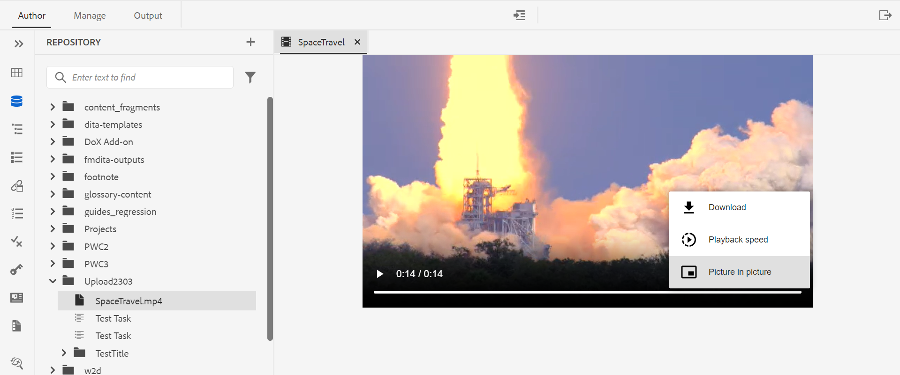

# Novidades da versão de março de 2023 do Adobe Experience Manager Guides as a Cloud Service

Este artigo aborda os recursos novos e aprimorados da versão de março de 2023 do Adobe Experience Manager Guides (mais tarde conhecido como *AEM Guides as a Cloud Service*).

Para obter mais detalhes sobre as instruções de atualização, a matriz de compatibilidade e os problemas corrigidos nesta versão, consulte o artigo [Notas de versão](release-notes-2023-3-0.md).

## Abrir e reproduzir arquivos de vídeo ou áudio no Editor da Web

O AEM Guides agora fornece o recurso para abrir e reproduzir os arquivos de áudio ou vídeo no Editor da Web. Você pode alterar o volume ou a visualização do vídeo. No menu de atalho, você também tem opções para **Baixar**, alterar **Velocidade de Reprodução** ou exibir **Picture in Picture**.

