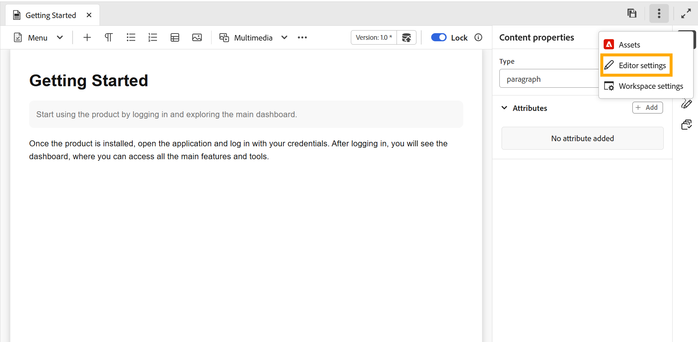
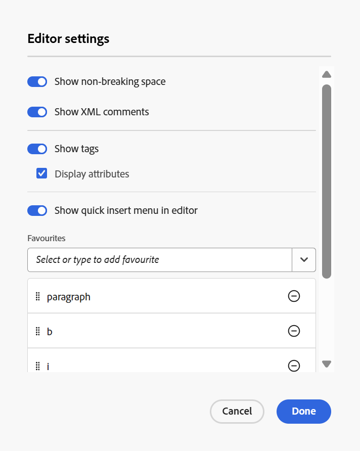
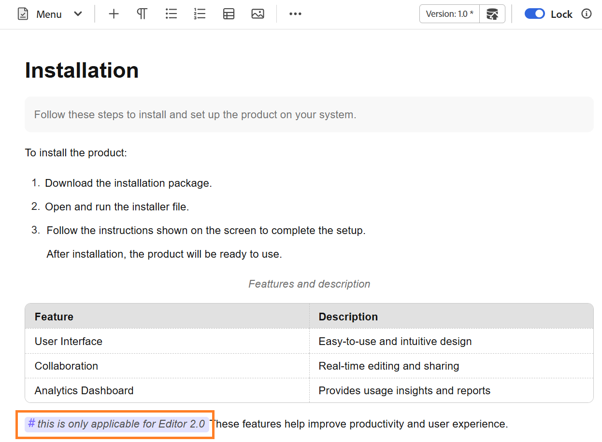
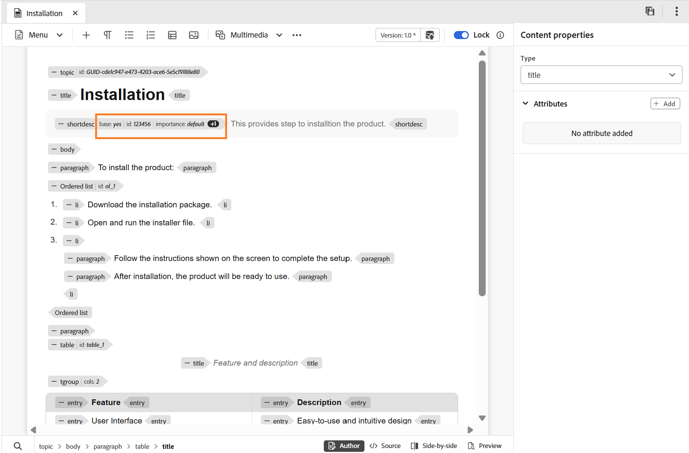
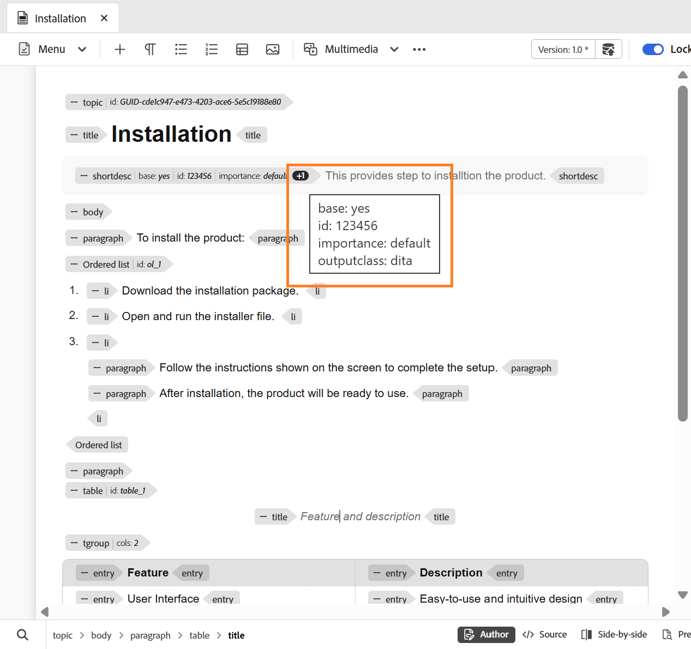
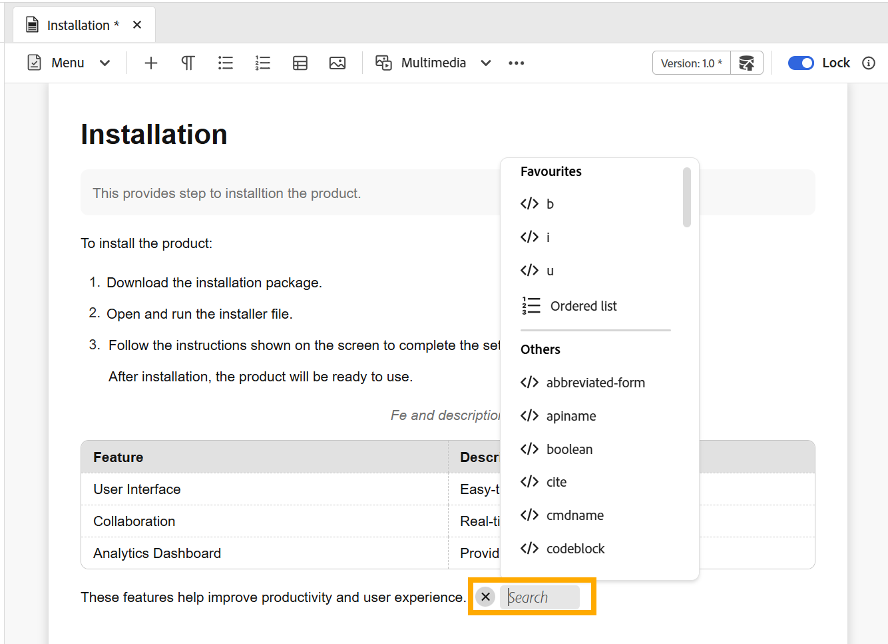

# Configurações do editor

>[!NOTE]
>
> Este artigo se aplica somente ao Novo editor. Para ativar esse recurso em seu ambiente, entre em contato com a equipe de Sucesso do cliente da AEM Guides.

As configurações do Editor fornecem um painel de configuração centralizado que permite personalizar o comportamento do Editor em um nível de autor individual. Ele oferece maior flexibilidade, consistência e controle durante o processo de criação.

Esse painel de configurações centralizado permite gerenciar as principais preferências do Editor de um único local, reduzindo a necessidade de configurações dispersas ou manuais. As configurações do Editor podem ser acessadas de **Mais ações** na barra de guias.

{width="650"}

## Opções de configuração compatíveis

Você pode ativar ou desativar as seguintes opções com base nas suas preferências:

{width="350"}

- **Espaços não separáveis**: habilite esta opção para mostrar um indicador para os espaços não separáveis ao editá-lo no Editor. É visível somente na exibição Autor para o tópico DITA e mapas DITA
- **Comentários XML**: permite que os autores exibam, editem e insiram comentários XML diretamente no modo Autor, para melhor visibilidade do conteúdo. Quando ativados, os autores podem exibir, inserir, editar e excluir comentários XML diretamente no conteúdo no próprio modo Autor, facilitando a adição de notas contextuais para colaboradores. Quando desativados, os comentários XML ficam ocultos no modo Autor e não podem ser inseridos ou modificados nesse modo, garantindo uma experiência de criação mais limpa para os usuários que não precisam deles. Você pode continuar a exibir e criar comentários XML no modo de origem usando a sintaxe `<!-- test comment -->`.

  {width="650"}

- **Marcas**: controla a visibilidade das marcas no Editor. Quando ativadas, as tags estruturais são exibidas no conteúdo, permitindo que os autores visualizem e gerenciem a estrutura DITA subjacente. Quando desativadas, essas tags ficam ocultas para fornecer uma experiência de criação mais limpa e focada.

  {width="650"}

  Quando as configurações de **Mostrar marcas** estão habilitadas, você também pode habilitar **Exibir atributos** para exibir e validar os atributos associados a um elemento. Quando um elemento tiver mais de três atributos associados a ele, um indicador de contagem será exibido. Passar o mouse sobre o indicador exibe a lista completa de atributos aplicados a esse elemento.

   {width="650"}

- **Menu de inserção rápida no editor**: permite adicionar elementos diretamente ao editar no modo Autor, na posição do cursor, sem navegar até a barra de ferramentas. Os elementos usados com frequência também podem ser configurados em **Favoritos** para agilizar o acesso. O menu de inserção rápida está disponível diretamente no Editor quando você pressiona **Control + /** no Windows ou **Command + /** no macOS na posição do cursor.

  {width="650"}

  Você pode pesquisar e adicionar elementos aos seus Favoritos, remover os elementos adicionados anteriormente e reorganizá-los usando o simples arrastar e soltar. Os favoritos incluem os elementos usados com mais frequência e a ordem definida aqui é refletida no menu Inserção rápida quando acessado do editor.

  Este é um vídeo curto sobre como trabalhar com o menu de Inserção rápida no Novo editor.

  >[!VIDEO](https://video.tv.adobe.com/v/3491343)

