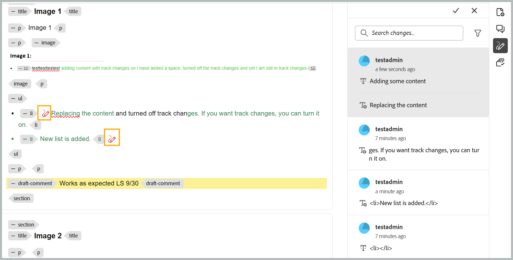
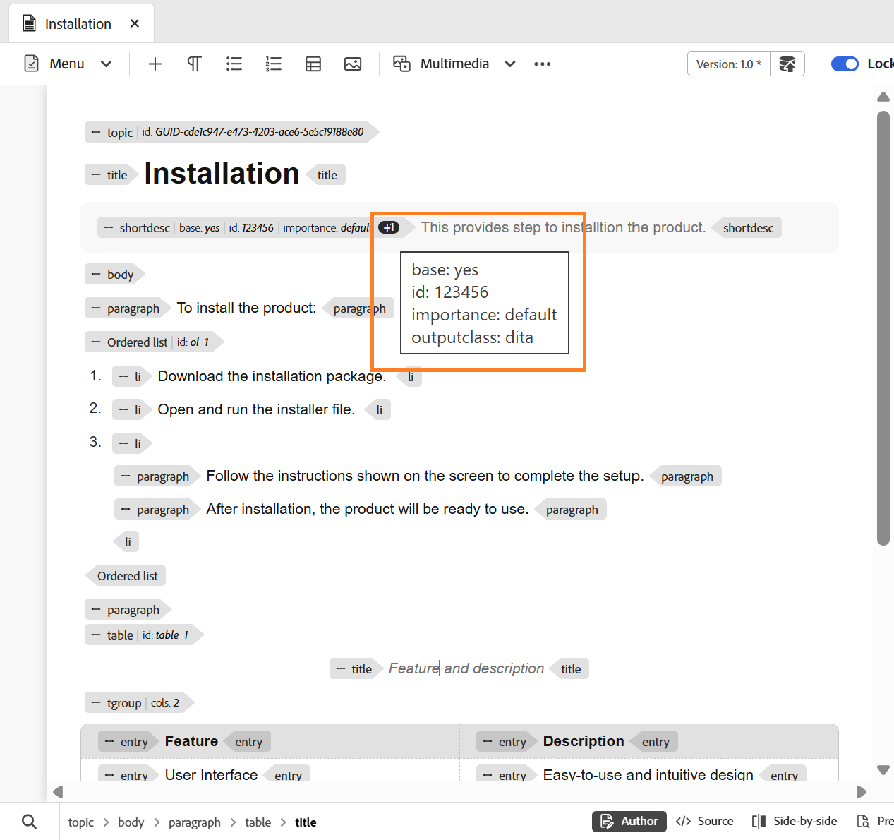

# Configurações do editor

>[!NOTE]
>
> Este artigo se aplica somente ao Novo editor. Para ativar esse recurso em seu ambiente, entre em contato com a equipe de Sucesso do cliente da AEM Guides.

As configurações do Editor fornecem um painel de configuração centralizado que permite personalizar o comportamento do Editor em um nível de autor individual. Ele oferece maior flexibilidade, consistência e controle durante o processo de criação.

Esse painel de configurações centralizado permite gerenciar as principais preferências do Editor de um único local, reduzindo a necessidade de configurações dispersas ou manuais. As configurações do Editor podem ser acessadas de **Mais ações** na barra de guias.

{width="650"}

## Opções de configuração compatíveis

As configurações do editor permitem personalizar várias opções, incluindo Controlar alterações, Mostrar tags, Menu de inserção rápida e muito mais, de acordo com suas preferências.

{width="350"}

### Rastrear alterações

>[!NOTE]
>
>- Esse recurso é ativado por padrão. Para desativá-lo, entre em contato com a equipe de Sucesso do cliente da AEM Guides.
>- Ao trabalhar com tabelas, a inserção de uma linha ou coluna é acompanhada, mas a exclusão de uma linha ou coluna não é acompanhada no painel Controlar alterações.

Habilite o modo **Controlar alterações** para registrar as edições feitas em um tópico. Uma vez habilitado, cada inserção e exclusão é capturada enquanto você trabalha, e todas as alterações são listadas no painel **Controlar alterações**. Edições consecutivas feitas na mesma posição são agrupadas e exibidas como uma única alteração no painel **Controlar alterações**.

O conteúdo excluído aparece com tachado, enquanto o conteúdo inserido aparece no texto verde. Além disso, as barras de alteração aparecem ao longo da borda da página de tópico, com barras vermelhas indicando o conteúdo excluído e barras verdes indicando o conteúdo adicionado. Se uma linha contiver adições e deleções, ambas as barras de alteração serão exibidas.

Quando vários usuários trabalham no mesmo tópico, o Rastrear alterações permite que visualizem as edições de cada um. Quando o conteúdo estiver pronto para ser finalizado, os usuários poderão revisar as alterações controladas e aceitá-las ou rejeitá-las.

{width="350"}

**Mostrar exclusões controladas embutidas**

Controla como o conteúdo excluído é exibido no Editor enquanto a opção Rastrear alterações está ativada. Quando ativado, o conteúdo excluído permanece visível em linha, em sua posição original, como texto tachado. Quando desativado, o conteúdo excluído não é exibido. Em vez disso, um ícone de lápis é exibido no local onde o conteúdo foi removido, fornecendo uma visualização mais clara do tópico. Selecione o ícone de lápis para ir para o conteúdo excluído correspondente no painel Alterações controladas.

{width="350"}

**Aceitar ou rejeitar alterações controladas**

Para revisar as alterações, selecione o ícone **Controlar alterações** no painel direito para abrir o painel Alterações controladas e execute as seguintes etapas:

1. Selecione uma alteração controlada no painel. O conteúdo alterado é selecionado no documento.
1. Aceite a alteração selecionando o ícone **Aceitar alteração** ou rejeite-a selecionando o ícone **Rejeitar alteração**.

   {width="650"}

1. Para aceitar ou rejeitar todas as alterações com um único clique, selecione **Aceitar todas as alterações** ou **Rejeitar todas as alterações** na parte superior do painel.

   {width="650"}

### Espaços não separáveis

Habilite esta opção para mostrar um indicador para os espaços não separáveis ao editá-lo no Editor. É visível somente na exibição Autor para o tópico DITA e mapas DITA.

### Comentários XML

Permite que os autores visualizem, editem e insiram comentários XML diretamente no modo Autor, para melhorar a visibilidade do conteúdo. Quando ativados, os autores podem exibir, inserir, editar e excluir comentários XML diretamente no conteúdo no próprio modo Autor, facilitando a adição de notas contextuais para colaboradores. Quando desativados, os comentários XML ficam ocultos no modo Autor e não podem ser inseridos ou modificados nesse modo, garantindo uma experiência de criação mais limpa para os usuários que não precisam deles. Você pode continuar a exibir e criar comentários XML no modo de origem usando a sintaxe `<!-- test comment -->`.

>[!NOTE]
>
> Para comentários XML, **Controlar alterações** registra somente a inserção ou exclusão do comentário inteiro. As edições feitas em um comentário XML existente não são registradas.

{width="650"}

### Tags

Controla a visibilidade das tags no Editor. Quando ativadas, as tags estruturais são exibidas no conteúdo, permitindo que os autores visualizem e gerenciem a estrutura DITA subjacente. Quando desativadas, essas tags ficam ocultas para fornecer uma experiência de criação mais limpa e focada.

{width="650"}

Quando as configurações de **Mostrar marcas** estão habilitadas, você também pode habilitar **Exibir atributos** para exibir e validar os atributos associados a um elemento. Quando um elemento tiver mais de três atributos associados a ele, um indicador de contagem será exibido. Passar o mouse sobre o indicador exibe a lista completa de atributos aplicados a esse elemento.

     {width=&quot;650&quot;}

### Menu de inserção rápida no editor

Permite adicionar elementos diretamente durante a edição no modo Autor, na posição do cursor, sem navegar até a barra de ferramentas. Os elementos usados com frequência também podem ser configurados em **Favoritos** para agilizar o acesso. O menu de inserção rápida está disponível diretamente no Editor quando você pressiona **Control + /** no Windows ou **Command + /** no macOS na posição do cursor.

{width="650"}

Você pode pesquisar e adicionar elementos aos seus Favoritos, remover os elementos adicionados anteriormente e reorganizá-los usando o simples arrastar e soltar. Os favoritos incluem os elementos usados com mais frequência e a ordem definida aqui é refletida no menu Inserção rápida quando acessado do editor.

Este é um vídeo curto sobre como trabalhar com o menu de Inserção rápida no Novo editor.

>[!VIDEO](https://video.tv.adobe.com/v/3491343)

