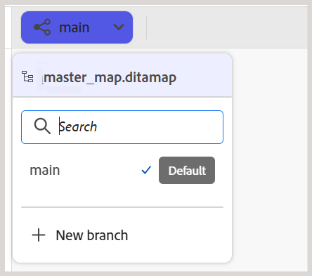
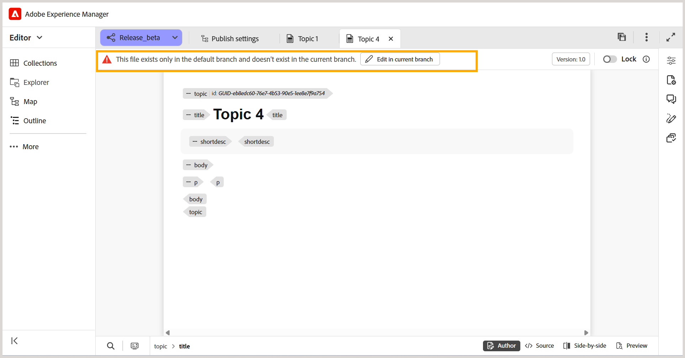
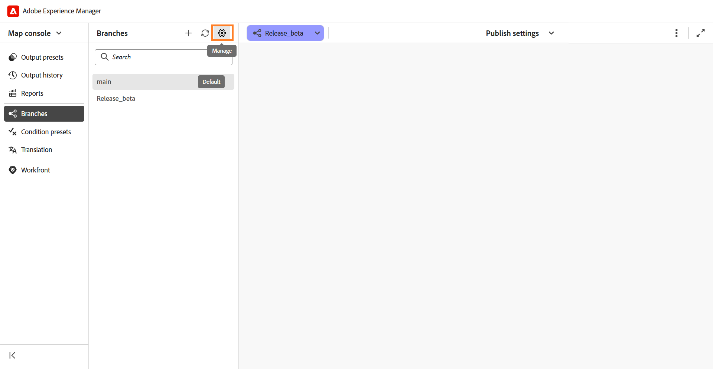
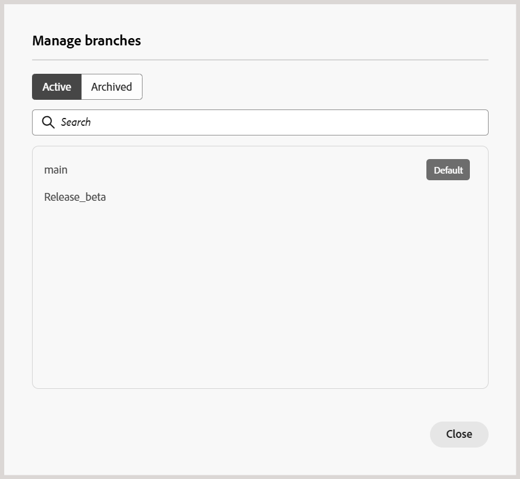

# Criar e gerenciar ramificações de um mapa DITA

No Experience Manager Guides, é possível criar várias ramificações de um mapa DITA para gerenciar a documentação de diferentes versões, recursos ou correções. Você pode alternar entre ramificações para trabalhar no conteúdo associado, arquivar ramificações que não são mais necessárias e restaurá-las quando necessário.

Você também pode criar uma ramificação de qualquer ramificação existente do mesmo mapa DITA.

## Criar uma ramificação

É possível criar uma ramificação de um mapa DITA para trabalhar em alterações na documentação sem afetar o conteúdo correspondente em outras ramificações.

Execute as seguintes etapas para criar uma ramificação:

1. Abra o mapa DITA para o qual deseja criar uma ramificação.

   >[!NOTE]
   >
   > Se outro mapa já estiver aberto no Editor, uma caixa de diálogo de confirmação será exibida. Selecione **Abrir** para abrir o mapa selecionado na ramificação atual. Para obter mais informações, exiba [Abrir conteúdo fora do contexto do mapa atual](#open-content-outside-the-current-map-context).

1. Selecione a lista suspensa de ramificação **principal** e verifique se o mapa DITA necessário está selecionado.

   

1. Selecione **Nova ramificação** para criar uma ramificação do mapa selecionado.

1. Na caixa de diálogo **Nova ramificação**, digite um nome para a nova ramificação e selecione a ramificação pai a partir da qual deseja criá-la.

   

1. Selecione **Criar**.

Uma nova ramificação é criada para o mapa DITA selecionado. Agora você pode alternar para a nova ramificação e começar a trabalhar no conteúdo associado.

## Alternar entre as ramificações

Execute as seguintes etapas para alternar ramificações:

1. Selecione a **lista suspensa de ramificações** na parte superior do Editor (que exibe `main` por padrão). A lista de ramificações disponíveis para o mapa DITA selecionado é exibida.
1. Selecione a ramificação com a qual deseja trabalhar.

   

   A ramificação selecionada é aberta e seu nome aparece na lista suspensa de ramificações na parte superior do Editor, substituindo **main**.

   

Agora é possível trabalhar no mapa e seu conteúdo associado dentro da ramificação selecionada.

>[!NOTE]
>
>Se um tópico tiver alterações não salvas ao alternar ramificações, será exibida uma caixa de diálogo solicitando que você salve as alterações antes de alternar para a ramificação selecionada.

Agora é possível trabalhar no mapa e seu conteúdo associado dentro da ramificação selecionada.

## Edição isolada em uma ramificação

Quando você trabalha em uma ramificação de um mapa DITA, as alterações feitas no conteúdo permanecem dentro da ramificação selecionada e não afetam o conteúdo correspondente em outras ramificações. Isso permite que vários autores trabalhem nos mesmos tópicos de maneira independente em diferentes ramificações de um mapa.

Por padrão, os tópicos inalterados são lidos da ramificação de origem ou `main`. Ao editar um tópico na ramificação selecionada, ele se torna parte dessa ramificação. Quaisquer alterações subsequentes no tópico permanecem dentro da ramificação selecionada.

Você pode alternar entre ramificações do mesmo mapa DITA para exibir e editar seu respectivo conteúdo.

### Editar tópicos em uma ramificação

É possível editar tópicos associados a um mapa DITA na ramificação selecionada sem afetar o conteúdo em outras ramificações.

Execute as seguintes etapas para editar um tópico:

1. Abra o mapa DITA no Editor.
2. Na lista suspensa ramificação, selecione a ramificação na qual deseja editar o tópico.
3. Abra o tópico que deseja modificar no mapa.
4. Faça as alterações necessárias no tópico.
5. Salve as alterações.

   Uma cópia do tópico modificado é salva na ramificação selecionada. O tópico correspondente em outras ramificações permanece inalterado.

Você pode continuar editando o tópico na ramificação selecionada ou alternar para outra ramificação para trabalhar em seu conteúdo.

### Abrir um mapa fora do contexto atual do mapa

No Experience Manager Guides, o **contexto do mapa** refere-se ao mapa DITA aberto atualmente no Editor.

Se você tentar abrir um mapa, tópico ou ativo que não faça parte do contexto do mapa atual, uma caixa de diálogo de confirmação será exibida com as seguintes opções:

- **Abrir:** substitui o contexto do mapa atual pelo conteúdo selecionado.
- **Abrir no editor:** abre o conteúdo em uma nova guia sem alterar o contexto do mapa atual.
- **Cancelar:** cancela a operação e retém o contexto do mapa atual.

Por exemplo, considere que `master_map.ditamap` está atualmente selecionado na ramificação **main**.

Se você tentar abrir outro mapa DITA, a seguinte caixa de diálogo de confirmação será exibida:

Selecione **Abrir** para alternar para o mapa selecionado.

O contexto do mapa da ramificação `main` é atualizado para o mapa recém-selecionado, permitindo que você trabalhe com seu conteúdo associado.

### Abrir ou editar tópicos fora do contexto do mapa atual

Os tópicos não referenciados pelo mapa não ficam disponíveis automaticamente na ramificação.

Selecione **Editar na ramificação atual** para disponibilizar esses tópicos para edição na ramificação selecionada.

Agora você pode editar o tópico sem afetar seu conteúdo no `main`. No entanto, o tópico não é adicionado automaticamente ao mapa DITA associado e não é incluído na saída publicada. Para incluir o tópico na saída, adicione-o ao mapa DITA.

## Gerenciar ramificações

Você pode gerenciar ramificações de um mapa DITA no painel **Ramificações** do console Mapa. É possível visualizar ramificações disponíveis, criar novas ramificações, mesclar ou renomear ramificações existentes e arquivar ramificações que não são mais usadas ativamente.

O painel **Ramificações** lista todas as ramificações disponíveis para o mapa DITA selecionado.

Para gerenciar uma ramificação, passe o mouse sobre ela e selecione o menu **Opções**. As seguintes ações estão disponíveis:

- **Nova ramificação:** crie uma nova ramificação a partir da ramificação selecionada.
- **Mesclar para principal:** [Mesclar alterações](./merge-branches.md) da ramificação selecionada para a ramificação `main`.
- **Renomear ramificação:** Altere o nome da ramificação selecionada.
- **Histórico de mesclagem:** Exibe um histórico de atividades de mesclagem. Essa opção está disponível somente após a criação de uma solicitação de mesclagem.
- **Arquivar ramificação:** Arquiva uma ramificação que não é mais usada ativamente.

  >[!NOTE]
  >
  > O Experience Manager Guides não oferece suporte à exclusão de ramificações. É possível arquivar ramificações que não são mais usadas ativamente.

Você também pode usar as opções na parte superior do painel **Ramificações** para procurar uma ramificação, atualizar a lista de ramificações ou criar uma nova ramificação.

### Arquivar uma ramificação

Você pode arquivar ramificações de um mapa DITA que não são mais usadas ativamente e restaurá-las quando necessário.

>[!NOTE]
>
> A ramificação padrão (`main`) não pode ser arquivada.

Para arquivar uma ramificação, execute as seguintes etapas:

1. No painel **Ramificações**, selecione o ícone **Gerenciar**.

   

   A caixa de diálogo **Gerenciar ramificações** é exibida.

   

   A caixa de diálogo contém as seguintes guias:

   - **Ativo:** Lista todas as ramificações ativas do mapa DITA selecionado.
   - **Arquivado:** lista todas as ramificações arquivadas do mapa DITA selecionado.

2. Na guia **Ativo**, passe o mouse sobre a ramificação que deseja arquivar e selecione **Arquivar**.

   

   A ramificação selecionada está arquivada e movida para a guia **Arquivado**.

### Restaurar uma ramificação arquivada

Você pode restaurar uma ramificação arquivada de um mapa DITA quando precisar retomar o trabalho em seu conteúdo.

Para restaurar uma ramificação arquivada, execute as seguintes etapas:

1. No painel **Ramificações**, selecione o ícone **Gerenciar**.
2. Na caixa de diálogo **Gerenciar ramificações**, selecione a guia **Arquivado**.
3. Localize a ramificação que você deseja restaurar e selecione **Restaurar**.

   A ramificação foi restaurada e aparece na guia **Ativo**.

