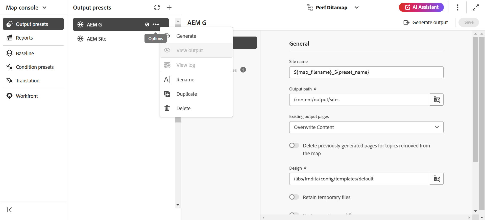
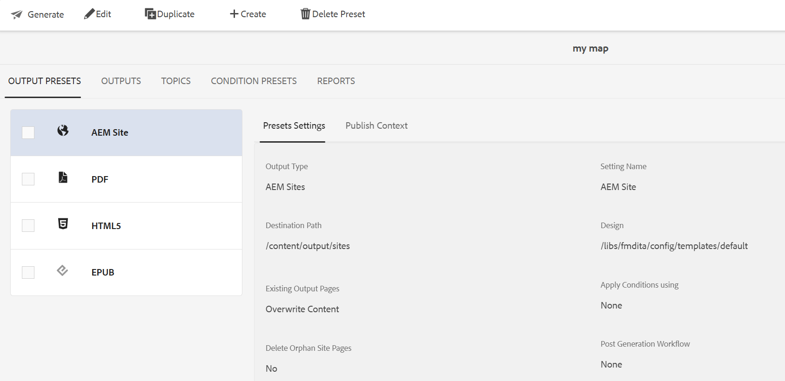

# Editar, duplicar ou excluir uma predefinição de saída {#id205BEH0K09Z}

É possível gerenciar predefinições de saída no console Mapa e no painel Mapa. De ambas as maneiras, você obtém opções para editar, duplicar e excluir uma predefinição de saída, conforme ilustrado na seção a seguir.

## Utilização do console de Mapa

É possível editar a predefinição de saída selecionada alterando diretamente os campos obrigatórios para as configurações de predefinição necessárias.

Além disso, você pode duplicar ou excluir uma predefinição de saída usando o menu suspenso **Opções**, como mostrado abaixo.

>[!NOTE]
>
>Não é possível editar, duplicar ou excluir uma predefinição de modelo. Essas ações estão restritas aos administradores do. Para saber mais sobre predefinições de modelo, consulte [Predefinições de modelo](../install-conf-guide/template-presets-output-generation.md).

## Uso do painel do Mapa

>[!NOTE]
>
>A partir da versão 2027.01.0 para Cloud Service e da versão 5.4 para No local do Experience Manager Guides, o recurso do painel de Mapa será descontinuado para novos clientes. No entanto, ela permanecerá ativada para clientes existentes que já a estão usando. Se desejar desativar o painel Mapa, entre em contato com a equipe de Sucesso do cliente. É recomendável usar o console Mapa para gerenciamento e publicação de mapas a partir de agora.

É possível editar, duplicar e excluir uma predefinição de saída usando o painel de mapa, selecionando a guia necessária na barra superior, como mostrado abaixo.

**Tópico pai:**[ Geração de saída](generate-output.md)
