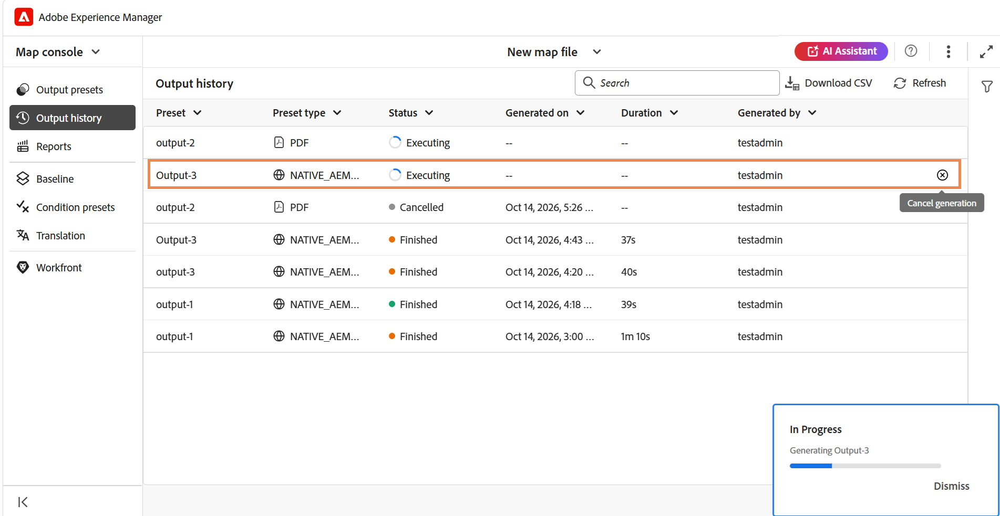
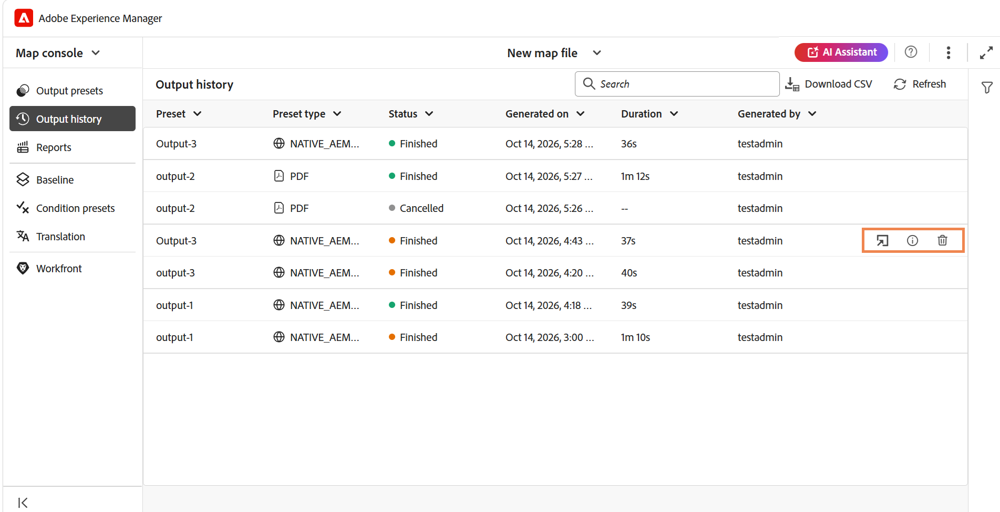
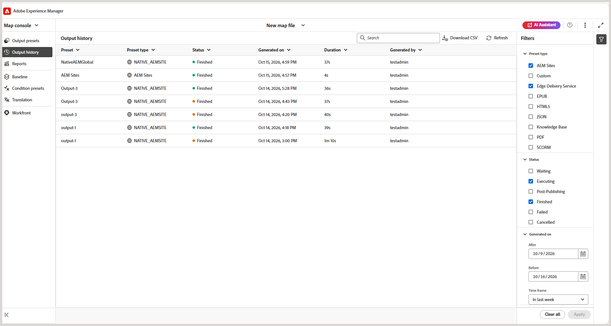
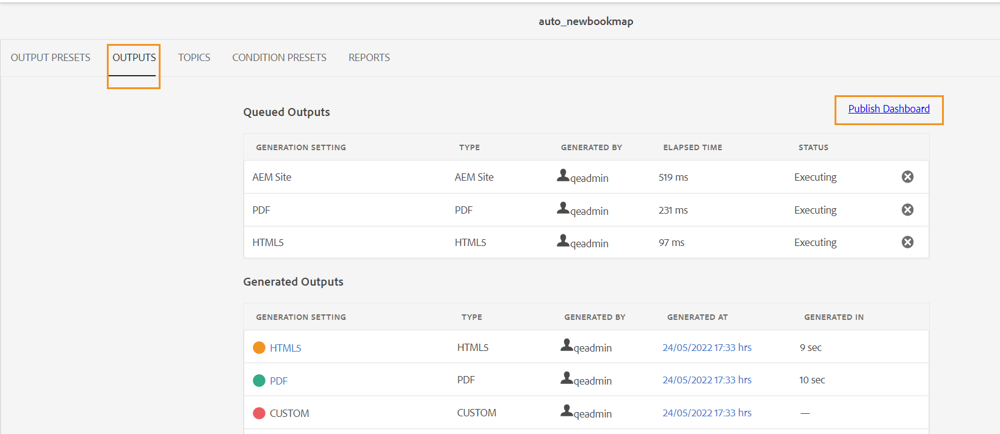
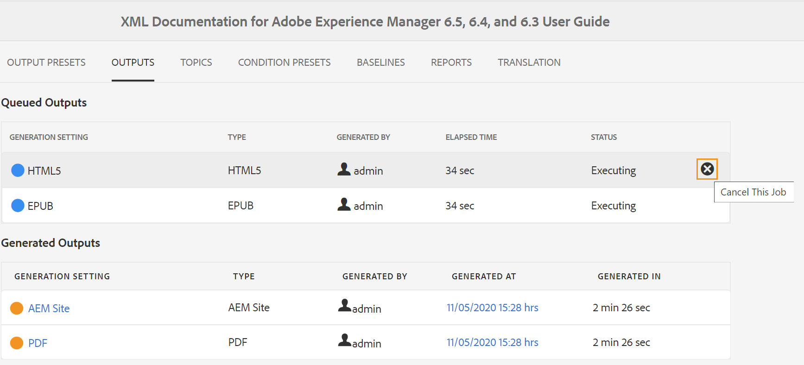
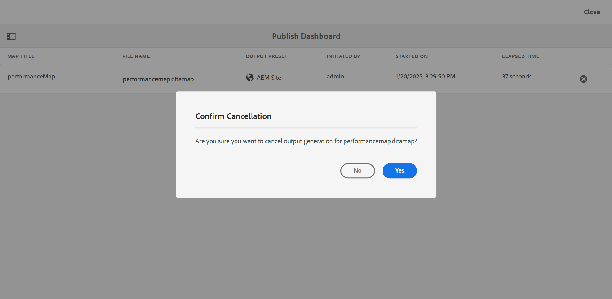
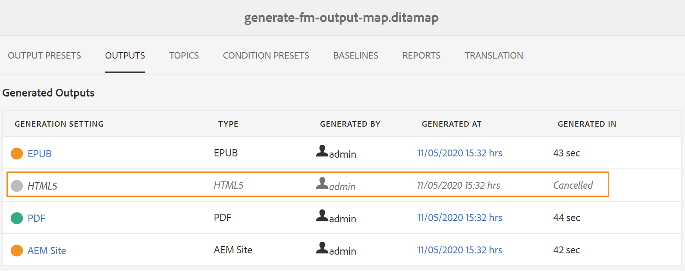
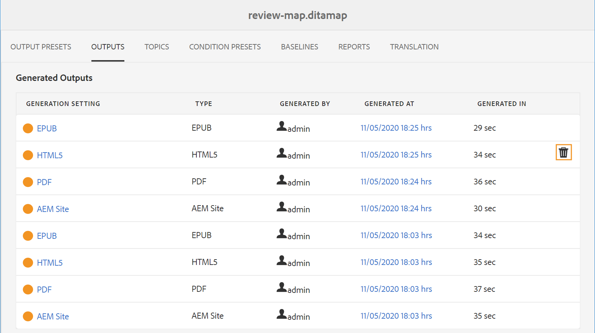

# Gerenciar processo de geração de saída

O Adobe Experience Manager Guides permite monitorar e gerenciar tarefas de geração de saída para seus mapas DITA. Você pode visualizar o status das tarefas de geração de saída, cancelar tarefas em andamento e remover entradas desatualizadas do histórico de geração de saída.

Depois de iniciar uma tarefa de geração de saída para um mapa ou gerar novamente os tópicos selecionados, o Experience Manager Guides envia a tarefa para a fila de geração de saída. O status da tarefa é atualizado à medida que o processo de geração de saída avança.

Você pode exibir e gerenciar tarefas de geração de saída usando a guia **Histórico de saída** no Editor ou a guia **SAÍDAS** na interface do Assets.

## Exibir e gerenciar tarefas de geração de saída no Editor

Você pode exibir e gerenciar tarefas de geração de saída diretamente na guia **Histórico de saída** do console de Mapa.

Abra o mapa DITA no console Mapa e gere a saída usando qualquer predefinição de saída disponível no Experience Manager Guides. Alterne para a guia **Histórico de saída** para exibir o status da tarefa de geração de saída e outros detalhes, conforme mostrado abaixo:

Para cada tarefa de geração de saída, você pode exibir as seguintes informações:

1. **Predefinição:** nome da predefinição de saída usada para gerar a saída.
1. **Tipo de predefinição:** Tipo de predefinição de saída usado para geração de saída.
1. **Status:** Status atual da tarefa de geração de saída, como Aguardando, Executando, Concluído, Com Falha, Pós-publicação ou Cancelado.
1. **Gerado em:** Data e hora da geração da saída.
1. **Duração:** tempo necessário para gerar a saída.
1. **Gerado por:** Nome do usuário que iniciou a tarefa de geração de saída.

>[!NOTE]
>
> Se uma tarefa de geração de saída estiver em andamento, o rótulo **Executando** na coluna **Status** indicará que a tarefa está sendo processada. Use a **Atualização** para exibir o status mais recente das tarefas de geração de saída.

Você também pode cancelar uma tarefa de geração de saída em andamento. Para cancelar uma tarefa em andamento, passe o mouse sobre a linha da tarefa e selecione **Cancelar geração**.

Quando a tarefa for cancelada, o rótulo **Cancelada** será exibido na coluna **Status**.

Para tarefas de geração de saída concluídas, passe o mouse sobre a linha de tarefa para acessar as seguintes ações, dependendo do status da tarefa:

- **Abrir saída:** Exiba a saída gerada em uma nova guia.
- **Exibir logs:** Acesse os logs de geração de saída para examinar os detalhes da publicação e solucionar erros ou avisos.
- **Excluir histórico de saída:** Remova a tarefa selecionada do histórico de geração de saída sem excluir a saída gerada.

Você também pode usar as seguintes opções para trabalhar com o histórico de geração de saída:

- **Pesquisa:** use o campo de pesquisa para localizar tarefas de geração de saída específicas no histórico.
- **Baixar CSV:** Selecione **Baixar CSV** para baixar o histórico de geração de saída no formato CSV.
- **Redimensionar coluna:** selecione a lista suspensa ao lado de um nome de coluna e selecione **Redimensionar coluna** para ajustar a largura da coluna.
- **Filtro**: aplique filtros com base no tipo de predefinição de saída, no status da tarefa e no intervalo de data e hora para restringir o histórico de geração de saída.

  

Além disso, os ícones codificados por cores indicam o status de cada tarefa: verde para tarefas bem-sucedidas, laranja para tarefas concluídas com mensagens e vermelho para tarefas com falha. Isso ajuda a identificar rapidamente as tarefas que exigem atenção.

## Exibir e gerenciar tarefas de geração de saída na interface do usuário do Assets

Usando a IA do Assets, você pode executar as seguintes ações na saída gerada:

- [Exibir o status da tarefa de geração de saída](#view-the-status-of-the-output-generation-task)
- [Cancelar uma tarefa de geração de saída](#cancel-an-output-generation-task)
- [Excluir uma tarefa de saída](#delete-an-output-task)

### Exibir o status da tarefa de geração de saída

Depois de iniciar a tarefa de geração de saída para um mapa ou gerar novamente os tópicos selecionados, o Experience Manager Guides envia essa tarefa para a fila de geração de saída. Essa fila é atualizada em tempo real, mostrando o status de cada tarefa de geração de saída na fila.

1. Na interface do usuário do Assets, navegue e abra o arquivo de mapa para o qual deseja verificar o status de geração de saída.

1. Selecione **SAÍDAS**.

   

   A página Saídas é dividida em duas partes:

   - **Saídas na Fila:**

     Lista as saídas que estão aguardando para serem geradas ou que estão em processo de geração. As tarefas em fila ou em andamento são mostradas com um ícone de cor azul antes do nome predefinido. Você também pode encontrar a configuração de geração de saída ou a predefinição usada para a tarefa na fila, o tipo, o usuário que iniciou a tarefa, o tempo desde quando a tarefa está na fila e o status atual.

     Selecione o link para acessar o **Painel de Publicação** e exibir o status atual de execução. Uma lista de todas as tarefas de publicação ativas está disponível no Painel de publicação. As **Saídas Enfileiradas** e o link **Painel de Publicação** são exibidos somente quando há saídas que estão aguardando geração ou que estão em processo de geração. Eles não aparecem quando as tarefas de saída são concluídas.Para obter mais detalhes sobre o Painel de Publicação, exiba [Gerenciar tarefas de publicação usando o Painel de Publicação](generate-output-publish-dashboard.md#).

   - **Saídas Geradas**

     Lista as tarefas de saída concluídas. Novamente, as informações mostradas aqui são semelhantes à seção Saídas em fila, com algumas diferenças. Você tem um novo conjunto de informações na forma de ícone de resultado de saída e o tempo de geração da saída.

     Nesta lista, você pode ter tarefas executadas com sucesso, tarefas executadas com mensagem ou tarefas com falha. As tarefas bem-sucedidas são mostradas com ícone de cor verde, as tarefas com uma mensagem têm um ícone de cor laranja e as tarefas com falha são mostradas com ícone de cor vermelha.

     Para todas as tarefas, o processo de publicação cria um arquivo de log \(logs.txt\) que pode ser acessado selecionando o link na coluna **Gerado às**. Para tarefas que falharam ou têm mensagens, você pode verificar o arquivo de log, o que é explicado na seção [Exibir e verificar o arquivo de log](generate-output-basic-troubleshooting.md#id1822G0P0CHS).

     >[!NOTE]
     >
     > Ao selecionar o link da saída gerada do PDF, você é solicitado a baixar a PDF.

### Cancelar uma tarefa de geração de saída

O Experience Manager Guides oferece aos editores uma maneira simples e fácil de cancelar qualquer tarefa de publicação em andamento. Como editor, você pode cancelar uma tarefa de publicação em andamento no console de mapas DITA ou no [Painel de Publicação](generate-output-publish-dashboard.md#).

Execute as seguintes etapas para cancelar uma tarefa de geração de saída no console do mapa DITA:

1. Na interface do usuário do Assets, navegue e abra o arquivo de mapa para o qual deseja cancelar uma tarefa de geração de saída em andamento.

1. Selecione **SAÍDAS**.

1. Na lista **Saídas em fila**, passe o ponteiro sobre uma tarefa que você deseja cancelar.

1. Selecione o ícone **Cancelar este trabalho**.

   

1. Selecione **Sim** no prompt de mensagem **Confirmar cancelamento**.

   

   Se a tarefa ainda não tiver sido iniciada, o comando cancel será executado na tarefa. Para uma tarefa que está sendo cancelada, o Status é definido como Canceling.

   Quando a tarefa for cancelada com êxito, ela será movida para a lista **Saídas Geradas** com o status **Cancelada**. Quando você passa o mouse sobre a tarefa cancelada, ele mostra o nome do usuário que cancelou a tarefa. Na captura de tela a seguir, a tarefa *HTML5* foi cancelada.

   

### Excluir uma tarefa de saída

Quando você gera várias saídas para um mapa DITA, durante um período de tempo, a lista Saídas geradas para esse mapa se torna muito longa. Como editor, você pode limpar o histórico de saída de qualquer arquivo de mapa removendo as tarefas desatualizadas da lista *Saídas Geradas*. Observe que a saída não é removida do sistema, apenas a entrada da saída gerada é removida da lista *Saídas Geradas*.

Execute as seguintes etapas para remover uma tarefa de saída da lista Saída Gerada:

1. Na interface do usuário do Assets, navegue até o arquivo de mapa do qual deseja excluir as tarefas, e abra-o.

1. Selecione **SAÍDAS**.

1. Na lista **Saídas geradas**, passe o ponteiro sobre uma tarefa que você deseja excluir.

1. Selecione o ícone de exclusão.

   

1. Selecione **Sim** no prompt de mensagem **Confirmar Exclusão**.

   A tarefa é excluída da lista Saída gerada.

