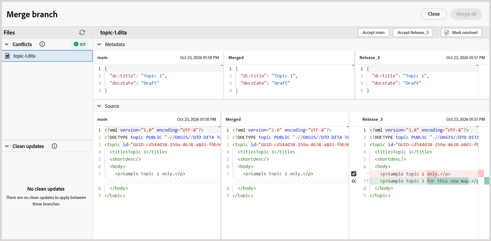

# Mesclar uma ramificação à principal

No Experience Manager Guides, você pode mesclar alterações de uma ramificação de um mapa DITA na ramificação `main`. A mesclagem permite incorporar atualizações concluídas na documentação do `main` sem copiar manualmente as alterações no `main`.

Por exemplo, considere um mapa DITA chamado `install-the-lift.ditamap` com uma ramificação chamada `Release 2`. Os autores podem atualizar as instruções de instalação nesta ramificação enquanto a documentação existente permanece inalterada no `main`.

Quando as atualizações estiverem prontas, os autores poderão mesclar as alterações de `Release 2` em `main`.

## Entender a mesclagem de ramificações

A mesclagem traz alterações de uma ramificação selecionada de um mapa DITA para a ramificação `main`.

- **Ramificação do Source:** a ramificação que contém as alterações que você deseja mesclar.
- **Ramificação de destino:** a ramificação padrão (`main`) na qual as alterações são mescladas.

Se a mesma parte de um tópico/mapa tiver sido modificada em ambas as ramificações, podem ocorrer conflitos de mesclagem que exigem resolução.

## Mesclar uma ramificação

Você pode mesclar alterações de uma ramificação selecionada de um mapa DITA em `main`.

Para mesclar uma ramificação, execute as seguintes etapas:

1. Abra o mapa DITA necessário no console Mapa.
2. Navegue até a guia **Ramificações**.
3. Localize a ramificação que contém as alterações que você deseja mesclar.
4. Abra o menu **Opções** da ramificação e selecione **Mesclar para principal**.

   

   Uma solicitação de mesclagem é criada para a ramificação selecionada. Ele permite que você revise as alterações e resolva quaisquer conflitos antes de mesclá-los no `main`.

   

5. Selecione a solicitação de mesclagem.

   A solicitação de mesclagem é aberta na exibição **Merge branch**. Revise as alterações e resolva os conflitos, se necessário.
6. Conclua a mesclagem.

   Revise as alterações e resolva os conflitos, se necessário. Para obter mais informações, consulte [Resolver conflitos de mesclagem](#resolve-merge-conflicts).

   Depois que todos os conflitos forem resolvidos, selecione **Mesclar tudo** para mesclar as alterações em `main`.

   As alterações são mescladas na ramificação `main`.

## Resolver conflitos de mesclagem

Um conflito de mesclagem ocorre quando o mesmo conteúdo foi modificado em `main` e na ramificação que está sendo mesclada. Você deve resolver todos os conflitos antes de mesclar as alterações em `main`.

Quando você abre uma solicitação de mesclagem, as seguintes seções são exibidas na exibição **Ramificação de mesclagem**:

- **Conflitos:** Lista os arquivos que exigem resolução de conflitos.
- **Limpar atualizações:** Lista os arquivos que podem ser mesclados sem resolver conflitos.

Para arquivos com conflitos, é exibida uma exibição **Mesclar ramificação**.

A exibição **Mesclar ramificação** contém os seguintes painéis:

- **Painel esquerdo (principal):** Exibe o conteúdo da ramificação padrão (`main`).
- **Painel do meio (Mesclado):** Exibe o conteúdo mesclado, onde você pode aceitar as alterações de qualquer ramificação ou editar o conteúdo diretamente.
- **Painel direito (ramificação selecionada):** Exibe o conteúdo da ramificação que está sendo mesclada em `main`.

As diferenças são destacadas nos painéis esquerdo e direito com base no conteúdo do painel **Mesclado**:

- **Vermelho (-):** Indica o conteúdo presente no painel **Mesclado** que difere do conteúdo no painel esquerdo ou direito correspondente.
- **Verde (+):** indica o conteúdo presente no painel esquerdo ou direito que não está incluído no painel **Mesclado**.

Inicialmente, o painel **Mesclado** contém o mesmo conteúdo que `main`, portanto, as diferenças são realçadas no painel direito. Depois que você aceitar as alterações da ramificação selecionada, o painel esquerdo mostrará diferenças em comparação com o painel **Mesclado** atualizado.

Execute as seguintes etapas para resolver conflitos de mesclagem:

1. Na seção **Conflitos**, selecione o arquivo que contém conflitos.

   >[!NOTE]
   >
   > Os arquivos listados em **Limpar atualizações** contêm alterações feitas apenas na ramificação selecionada e, portanto, não exigem resolução de conflitos.

2. Revise as diferenças destacadas na exibição **Ramificação de mesclagem** e resolva os conflitos usando os controles de mesclagem.

   A caixa de seleção ao lado de um conflito no painel direito determina como o conteúdo da ramificação selecionada é adicionado ao painel **Mesclado**:

   - **Selecionado (padrão):** substitui o conteúdo correspondente no painel **Mesclado** pelo conteúdo de ramificação selecionado.
   - **Limpo:** Adiciona o conteúdo da ramificação selecionada ao lado do conteúdo existente no painel **Mesclado** sem substituí-lo.

   Você pode resolver conflitos usando as seguintes opções:

   - Se quiser usar as alterações da ramificação selecionada, mantenha a caixa de seleção referente ao conflito selecionada e selecione o controle de seta para a esquerda correspondente (`<<<`). O conteúdo da ramificação selecionada substitui o conteúdo conflitante no painel **Mesclado**.

     

   - Se quiser manter o conteúdo de ambas as ramificações, desmarque a caixa de seleção referente ao conflito e selecione o controle de seta para a esquerda (`<<<`). Isso adiciona o conteúdo da ramificação selecionada ao painel **Mesclado** sem substituir o conteúdo já presente nesse painel.

     

   - Se você aceitou alterações da ramificação selecionada e deseja restaurar o conteúdo correspondente de `main`, selecione o controle de seta para a direita (`>>>`) no painel esquerdo. Isso substitui o conteúdo selecionado no painel **Mesclado** pela versão de `main`.

   >[!TIP]
   >
   > Passe o mouse sobre um controle de seta para ver como a aceitação da alteração selecionada afetará o painel **Mesclado**.

3. Depois de revisar o conteúdo mesclado, você também pode usar uma das seguintes opções para aceitar todo o conteúdo de qualquer ramificação:

   - **Aceitar principal:** substitui o conteúdo do painel **Mesclado** para o arquivo selecionado pela versão de `main`.
   - **Aceitar [nome da ramificação]:** substitui o conteúdo no painel **Mesclado** para o arquivo selecionado pela versão da ramificação selecionada.

   >[!NOTE]
   >
   > Selecionar qualquer uma das opções substituirá todo o conteúdo do **Painel mesclado** para o arquivo selecionado, incluindo todas as alterações feitas manualmente durante a resolução de conflitos.

   Como alternativa, você pode revisar ou editar o conteúdo diretamente no painel **Mesclado** e selecionar **Marcar como resolvido** para manter o conteúdo mesclado.

4. Revise o conteúdo final no painel **Mesclado** e selecione **Marcar como resolvido** para marcar o arquivo como resolvido.

5. Repita as etapas para todos os arquivos listados em **Conflitos**.

   Depois que todos os conflitos forem resolvidos, a opção **Mesclar tudo** ficará disponível.

6. Selecione **Mesclar tudo** para mesclar os arquivos resolvidos e as atualizações limpas em `main`.

   >[!NOTE]
   > 
   > A opção **Mesclar tudo** permanece desabilitada até que todos os conflitos sejam resolvidos.

   As alterações resolvidas foram mescladas em `main`. Uma mesclagem concluída não pode ser desfeita. No entanto, é possível criar uma nova solicitação de mesclagem para mesclar as alterações subsequentes no principal.

## Gerenciar uma solicitação de mesclagem

É possível gerenciar solicitações de mesclagem existentes usando o menu de contexto.

Para gerenciar uma solicitação de mesclagem, abra o menu de contexto e selecione uma das seguintes opções:

- **Visualização:** mostra as alterações na solicitação de mesclagem sem mesclá-las.
- **Exibir log:** Exiba o log associado à solicitação de mesclagem.
- **Excluir:** exclua a solicitação de mesclagem. A ramificação e suas alterações não são afetadas.
- **Exibir relatório:** Exibir o relatório de mesclagem após a ramificação ter sido mesclada em `main`.