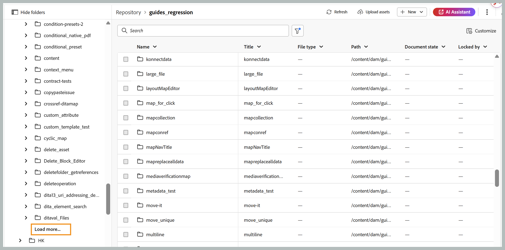
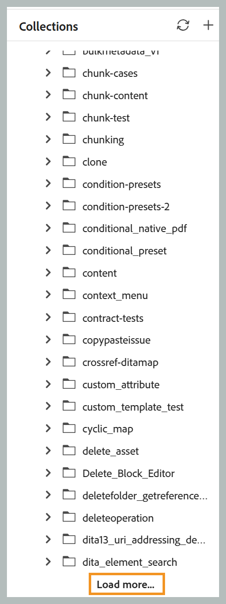
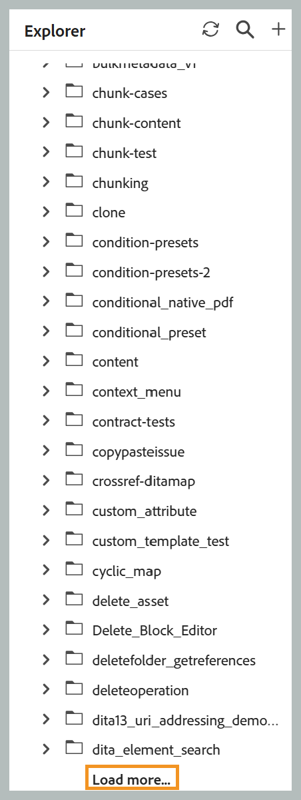
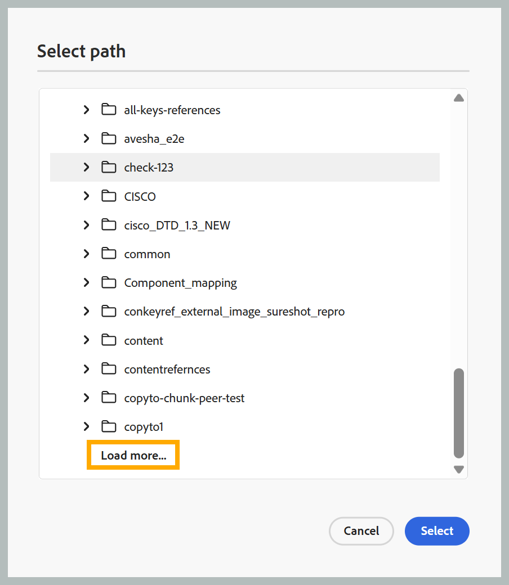

## Carregamento paginado de arquivos e pastas

>[!NOTE]
>
> Esse recurso é ativado por padrão. Para desativá-lo, entre em contato com a Equipe de sucesso do cliente.

O Experience Manager Guides usa uma API paginada para carregar arquivos e pastas. Em vez de carregar todo o conteúdo de uma só vez, as pastas são carregadas progressivamente em lotes, com ativos adicionais recuperados automaticamente à medida que você rola a tela ou selecionando a opção **Carregar mais**.

A classificação é realizada no lado do servidor, portanto, a aplicação de uma ordem de classificação busca resultados recém-classificados em vez de reordenar dados já carregados no navegador. Operações comuns, como renomear, excluir, adicionar e mover, não recarregam mais uma pasta inteira. Em vez disso, atualizam somente o item afetado ou atualizam a primeira página de resultados. A funcionalidade *Sempre localizar um arquivo no Explorer* também não está mais disponível. Para qualquer ativo, ainda é possível usar o menu de contexto para localizar o arquivo no Explorer.

As seções abaixo descrevem como cada uma dessas opções se aplica a interfaces, painéis e caixas de diálogo diferentes.

### Tabela Repositório inicial

- **Navegação**: usa rolagem infinita. O primeiro lote de ativos é carregado inicialmente; os lotes subsequentes são anexados automaticamente à medida que você rolar a tela. Alternar pastas limpa a lista atual e carrega os ativos da pasta recém-selecionada.
- **Renomear**: no local; sem atualização de pasta.
- **Excluir**: a pasta raiz é atualizada para mostrar o primeiro lote de ativos.
- **Adicionar**: o novo arquivo é inserido na parte superior (da pasta atual). Metadados adicionais, como estado do documento, status de bloqueio, tipo de arquivo, data de criação e outros detalhes são buscados em uma única solicitação em segundo plano em lote e preenchidos automaticamente após algum tempo.
- **Mover**: mover um arquivo para a pasta ativa o adiciona na parte superior; mover um arquivo para fora da pasta ativa atualiza a pasta para seu primeiro lote de ativos.
- **Botão Atualizar**: recarrega a pasta ativa, mostrando o primeiro lote de ativos.
- **Classificação**: exibir a primeira página classificada com rolagem infinita.
- **Painel de navegação de pasta**: abrir uma pasta carrega o primeiro lote de ativos, com uma opção **Carregar mais** anexada para lotes subsequentes.

  {width="650"}

### Coleções

- A adição de um arquivo o insere na parte superior da pasta sem atualizar a pasta.
- Abrir uma pasta carrega o primeiro lote de ativos, com uma opção **Carregar mais** anexada para lotes subsequentes.

  {width="650"}

### Explorer

- **Pasta raiz**: rolagem infinita. Inicialmente, o primeiro lote de ativos é carregado; os lotes subsequentes são anexados automaticamente à medida que você rolar a tela.
- **Pastas secundárias**: a expansão de uma pasta carrega o primeiro lote de ativos, com uma opção **Carregar mais** anexada aos lotes subsequentes.

  {width="650"}

- **Renomear**: ocorre no local sem atualização de pasta.
- **Excluir**: a pasta raiz é atualizada para mostrar o primeiro lote de ativos.
- **Adicionar ou duplicar**: o novo arquivo aparece na parte superior da pasta.
- **Mover**: mover entre pastas não relacionadas atualiza a pasta de origem para seu primeiro lote de ativos e adiciona o item na parte superior do destino (carregando o primeiro lote de ativos do destino, se ele ainda não estiver aberto).
- **Atualizar**: um novo botão de atualização no cabeçalho do painel Explorer recarregará o nível raiz, mostrando o primeiro lote de ativos.

### Painel Pesquisar

- Os resultados da pesquisa de navegação usam rolagem infinita. Inicialmente, o primeiro lote de ativos é carregado; os lotes subsequentes são anexados automaticamente à medida que você rolar a tela.

### Painel Modelo

- O nível raiz mostra apenas as categorias **mapa** e **tópico**. Expandir uma subpasta carrega o primeiro lote de ativos, com uma opção **Carregar mais** anexada para lotes subsequentes.

### Caixa de diálogo Selecionar caminho

- Cada nó de pasta carrega o primeiro lote de ativos, com uma opção **Carregar mais** anexada para lotes subsequentes.

  {width="650"}

- Quando a caixa de diálogo é aberta e navega para um caminho de destino específico, a árvore se expande automaticamente da raiz para o destino. As pastas no caminho são carregadas com um tamanho de página maior, enquanto a pasta de destino é carregada com o tamanho de lote padrão.