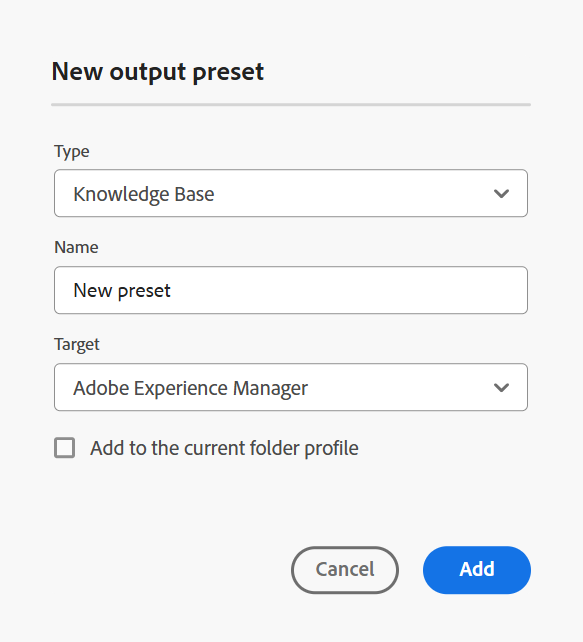
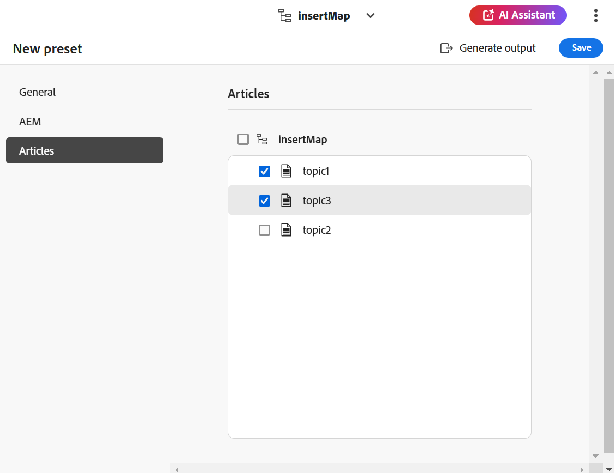
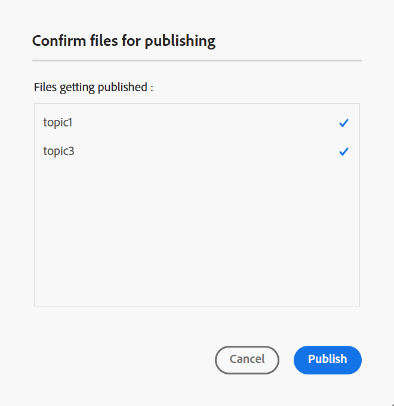
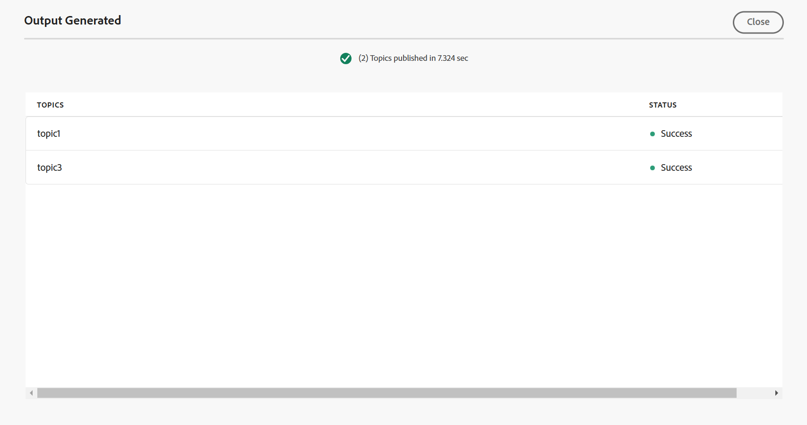

# Criar predefinições de saída para Knowledge Base no Editor {#id218CL400JW3}

Execute as seguintes etapas para criar predefinições de saída para o mapa DITA:

1. Na interface do usuário do Assets, navegue até o arquivo de mapa que deseja editar.

1. Para obter um bloqueio exclusivo no arquivo de mapa, selecione o arquivo de mapa e selecione **Check-out**.

1. Selecione a opção **Editar Tópicos** no menu de ações no arquivo de mapa.

   O arquivo de mapa é aberto para edição no Editor.

   >[!NOTE]
   >
   > É possível adicionar ou excluir qualquer tópico do mapa usando o Editor de mapa avançado. Para obter mais detalhes, consulte [Trabalhar com o Editor de Mapa Avançado](map-editor-advanced-map-editor.md#).

1. Selecione o ícone **Abrir no console de mapa**. O mapa é aberto no console do mapa.

1. Navegue até a guia **Predefinições de saída** e selecione o ícone + para criar uma predefinição de saída para o mapa DITA.

1. Selecione **Base de Dados de Conhecimento** no menu suspenso **Tipo**, digite o nome e selecione **Adobe Experience Manager** na caixa de diálogo **Nova predefinição de saída**.
1. Selecione a opção **Adicionar ao perfil de pasta atual** para criar uma predefinição de saída para o perfil de pasta atual. O ícone  indica uma predefinição de nível de perfil de pasta.

   Saiba mais sobre [Gerenciar predefinições de saída de Perfil Global e de Pasta](./web-editor-manage-output-presets.md).

1. Selecione **Adicionar**.

   A predefinição da Knowledge Base é criada.

   

Depois que a predefinição é criada, é possível gerar a saída para artigos específicos da base de conhecimento. Para fazer isso, navegue até a guia **Artigos** e selecione os tópicos para os quais deseja gerar a saída.
1. Selecione **Gerar saída** na parte superior para gerar a saída.

   

1. No prompt **Confirmar arquivos para publicação**, selecione os arquivos que deseja publicar e confirme selecionando **Publicar**.

   

Você visualizará o status do processo de geração de saída. A coluna **Tópicos** lista os tópicos para os quais a saída está sendo gerada, enquanto a coluna **Status** exibe o status de publicação de cada tópico.

Para exibir a saída, feche a caixa de diálogo Saída Gerada e selecione **Exibir saída** na página predefinida.

>[!NOTE]
>
> Também é possível Renomear, Duplicar ou Excluir uma predefinição de saída existente no menu Opções.

**Tópico pai:**&#x200B;[&#x200B; Publicação baseada em artigo do Editor](web-editor-article-publishing.md)
