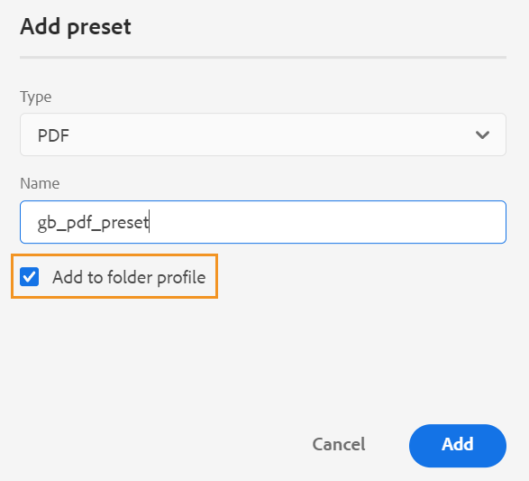

# Gerenciar predefinições de saída de perfil global e de pasta {#id22BLJ0D0V1U}

As predefinições Global e Perfil de pasta só estão disponíveis para usuários administrativos no nível da pasta.

Como administrador, o Adobe Experience Manager Guides permite criar e gerenciar predefinições de saída para os Perfis global e de pasta. Em seguida, é possível usar facilmente essas predefinições de saída para gerar saída para todos os mapas relacionados a esse Perfil global ou de pasta.

Execute as seguintes etapas para criar uma predefinição de saída para os Perfis global e de pasta:

1. Selecione o mapa DITA para o qual deseja criar uma predefinição de saída.
1. Selecione a opção **Editar Tópicos** no menu **Opções** do arquivo de mapa. O arquivo de mapa é aberto para edição no Editor.
1. Selecione o ícone **Abrir no console de mapa** para abrir o arquivo de mapa no console de Mapa.
1. No console Mapa, navegue até a guia **Predefinições de saída** e selecione o ícone + para criar uma predefinição de saída para seu mapa DITA.

   {width="350"}

1. Insira os seguintes detalhes na caixa de diálogo **Adicionar predefinição**:
   - Tipo
   - Nome
   - Target \(para predefinição da Base de conhecimento\)
1. Marque a caixa de seleção **Adicionar ao perfil de pasta** para criar uma predefinição de saída para o perfil de pasta relacionado e selecione **Adicionar**. A predefinição é criada e aparece na guia **Predefinições de saída** de todos os mapas relacionados. O ícone \( \) indica uma predefinição de nível de perfil de pasta.
1. Insira os detalhes da configuração. Para obter mais detalhes sobre predefinições de saída, consulte [Noções básicas sobre as predefinições de saída](./generate-output-understand-presets.md).

   >[!NOTE]
   >
   > Essas predefinições adicionadas ao perfil da pasta são independentes dos mapas, de modo que as configurações específicas do mapa não estão presentes para essas predefinições.

1. Você pode selecionar o ícone **Gerar saída** no canto superior direito para gerar a saída dos mapas relacionados à predefinição de saída criada. Você pode visualizar o status do processo de geração de saída. Para exibir a saída, selecione **Exibir Saída** na caixa de diálogo **Sucesso**.

>[!NOTE]
>
> O Experience Manager Guides também fornece uma predefinição de saída pronta para uso do PDF para gerar a saída para seus mapas DITA.

**Outras operações do menu Opções**

No menu Opções, também é possível executar as seguintes operações na predefinição:

- **Gerar saída**: permite gerar uma saída para uma predefinição existente.
- **Exibir saída** e **Exibir log**: links rápidos para exibir a saída e os logs gerados.
- **Renomear**, **Duplicar** ou **Excluir** uma predefinição de saída existente do menu **Opções**.
- **PDF padrão**: permite selecionar a predefinição PDF existente como predefinição pdf padrão. A predefinição selecionada seria, então usada como a predefinição padrão para gerar a saída do PDF usando a opção **Baixar como PDF** para um mapa.

>[!NOTE]
>
> Quando uma predefinição de saída em Perfis globais e de pasta for excluída, ela será refletida em todos os mapas relacionados e não aparecerá na guia **Predefinições de saída**.

**Tópico pai:**[ Trabalhar com o Editor da Web](web-editor.md)
